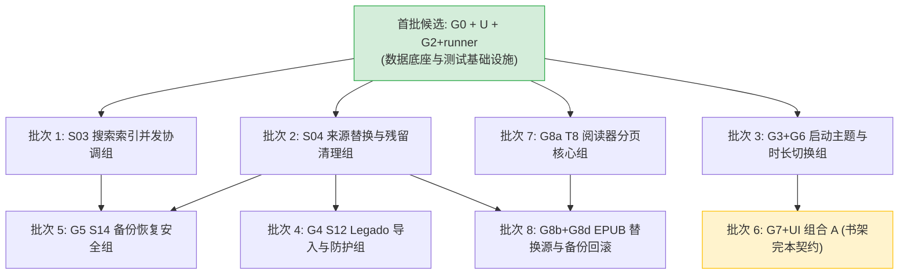
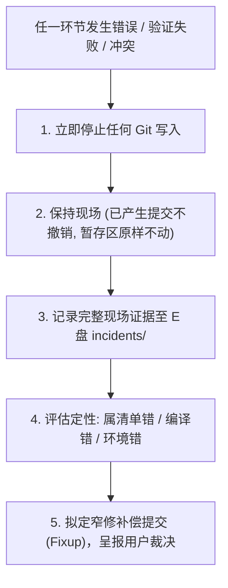

# 阶段 E：创作阅读助手只读集成决策材料（2026-09-29）

> **Codex 后续复核（2026-09-29）：** 本报告的“联合验收待回读”已过时；ZCode 联合候选 8/8 与持久文件 53/53 的限定证据见 [复核](../../reviews/2026-09/2026-09-29-stage-e-combined-and-decision-review.md)。下文 8 个批次尚未隔离编译，65 项摘要只列 56 项，544 条状态为旧快照；不得直接当作可执行提交单。E 盘增量保护不需要另设用户授权，stage/commit 仍遵守项目 §E 的明确授权门槛。

> **性质声明**：本文件是创作阅读助手阶段 E 的**只读集成决策方案与执行材料**，不是自动执行令。
> - 工作目录：`D:\develop\Code\Codex\creation-reading-assistant-recovery-20260919`（分支 `codex/recover-worktree-20260920`，HEAD `5aed5939600e491843e3c44453921bd6273a233c`）。
> - 角色与约束：本会话严格只读，**未修改**任何产品源码、测试代码或共享配置文件；**未操作** ADB/MuMu；**未修改** ZCode 报告；**绝不执行** `git stage`、`commit`、`push`、`reset`、`checkout`，**绝不使用** `git add -A`，**绝不提出**清空工作树。
> - 状态诚实原则：ZCode 正在并行修改 `CraIsolatedTestRunner.kt` 并独占 MuMu 进行联合验收，在联合设备结果正式回读前，本方案恒标**“待回读”**，绝不预写通过；普通 debug 变体在真实设备上标记为**“设备 NOT RUN”**；证据不足或无产品合同支撑项一律保持 **HOLD**。

---

## 目录

1. [首批候选组合（G0、U、G2+runner）决策包](#1-首批候选组合g0ug2runner决策包)
2. [余下 Android HOLD 矩阵（约 180 行）最小可编译批次分组](#2-余下-android-hold-矩阵约-180-行最小可编译批次分组)
3. [原目录差异与独有资产逐项去向清单](#3-原目录差异与独有资产逐项去向清单)
4. [收口计划 §E 落地：必须向用户展示的清单、授权边界与失败停止点](#4-收口计划-e-落地必须向用户展示的清单授权边界与失败停止点)

---

## 1. 首批候选组合（G0、U、G2+runner）决策包

首批候选组合聚焦于解决最关键的**数据丢失高危缺陷**与**数据库 Schema 升级断裂**，并提供沙箱运行所必需的测试基础设施。

### 1.1 精确文件与 hunk 清单

首批候选由三个紧密协同的子单元组成：

#### (1) 候选 G0：Room v15 冗余索引删除与迁移（数据基础）
- **目标**：将 Room Schema 版本由 14 升至 15，物理移除 `search_terms` 表上的冗余单列索引 `index_search_terms_term`（仅保留复合索引 `index_search_terms_book`），消除开库 Schema 校验不匹配风险。
- **文件与 hunk 级精确边界**：
  1. `android/app/src/main/java/com/creationreadingassistant/data/local/AppDatabase.kt`（2 个 hunk，全部纳选）：
     - `@@ -70 +70 @@`：`APP_DATABASE_SCHEMA_VERSION = 14 → 15`
     - `@@ -530,0 +531,19 @@`：新增 `MIGRATION_14_15`（执行 `dropPartialIndexes` 与 `DROP INDEX IF EXISTS index_search_terms_term`）
  2. `android/app/src/main/java/com/creationreadingassistant/data/local/DatabaseModule.kt`（3 个 hunk，全部纳选）：
     - `@@ -50 +50 @@` 与 `@@ -52 +52,2 @@`：注释更新（说明 14→15 仅删除冗余索引）
     - `@@ -70,0 +72 @@`：向 Room 迁移列表注册 `AppDatabase.MIGRATION_14_15`
  3. `android/app/schemas/com.creationreadingassistant.data.local.AppDatabase/15.json`（未跟踪新文件，整文件纳选）：
     - Room v15 Schema 导出品，`identityHash` 由 `008e3a91...` 变为 `4dfc708f...`
  4. `android/app/src/main/java/com/creationreadingassistant/data/local/dao/SearchTermDao.kt`（**仅取 6 个 hunk 中的第 5 个**）：
     - **纳选 hunk 5**（`@@ -82 +73,9 @@`）：删除 `@Index(value = ["term"], name = "index_search_terms_term")`，替换为 9 行解释性注释。
     - **排除 hunk 1–4**（`deleteByChapter`、`countTerms`、`rowsByTerm` 删除，属死代码清理，非 G0 必需）。
     - **排除 hunk 6**（`SearchIndexCoverageDao.distinctBookIds`，属搜索孤儿回收，归后续 S03 批次）。
     - *硬约束说明*：Room 运行时 `TableInfo.equals` 对 indices 做严格集合比较。若 15.json 删除了索引而 Entity 声明未删，应用启动开库触发 `onValidateSchema` 时将直接崩溃！故 hunk 5 必须与 15.json 保持原子绑定。
  5. `android/app/src/androidTest/java/com/creationreadingassistant/data/local/AppDatabaseMigrationTest.kt`（全部 8 个 hunk / +311 行）：
     - 引入 Context、Room、SupportSQLiteDatabase 等依赖；
     - 新增 3 个 androidTest 守门用例：`migrate_14_to_15_drops_redundant_term_index`、`migrate_13_to_15_full_chain_keeps_old_data_and_creates_source_refs`、`openingDatabaseRebuildsPartialIndexesAndDoesNotResurrectTermIndex`。

#### (2) 候选 U：父表 @Upsert 级联安全修复 + 版本号 0.5.1(3)
- **目标**：彻底消除由于 Room `@Insert(onConflict = REPLACE)` 在 SQLite 底层触发 `DELETE + INSERT` 从而导致级联子表（如书籍正文、阅读进度、灵感、分类关系）被物理抹除的数据破坏灾难，改为 `@Upsert`（`DO UPDATE` 语义）。版本号提升至 0.5.1(3) 作为该修复的发布标记。
- **文件与 hunk 级精确边界**：
  1. `android/app/src/main/java/com/creationreadingassistant/data/local/dao/BookDao.kt`（5 个 hunk 中**仅取前 4 个**）：
     - `@@ -7,0 +8 @@`（B1）：`import androidx.room.Upsert`
     - `@@ -16 +17,22 @@`（B2）：`BookDao.upsert` 改为 `@Upsert` 并补充级联安全 KDoc
     - `@@ -22 +44 @@`（B3）：`softDelete` KDoc 澄清
     - `@@ -27 +49,2 @@`（B4）：`BookDao.upsertAll` 改为 `@Upsert`
     - **必须排除 hunk 5（B5）**（`@@ -38,0 +62,20 @@`）：新增 `getAllActive()` 与 `activeIds()`。其调用方分别为 Legado 进度导入和搜索孤儿回收，与父表级联安全无语义依赖，归后续批次。
  2. `android/app/src/main/java/com/creationreadingassistant/data/local/dao/InspirationDao.kt`（全部 2 个 hunk）：
     - `@@ -6,0 +7 @@`（I1）：`import androidx.room.Upsert`
     - `@@ -15 +16,9 @@`（I2）：`InspirationDao.upsert` 改为 `@Upsert`
  3. `android/app/src/main/java/com/creationreadingassistant/data/local/dao/TaxonomyDao.kt`（全部 4 个 hunk）：
     - `@@ -7,0 +8 @@`（T1）：`import androidx.room.Upsert`
     - `@@ -18 +19,8 @@`（T2）：`TagDao.upsert` 改为 `@Upsert`
     - `@@ -51 +59,2 @@`（T3）：`CategoryDao.upsert` 改为 `@Upsert`
     - `@@ -87 +96,2 @@`（T4）：`ShelfDao.upsert` 改为 `@Upsert`
  4. `android/app/src/androidTest/java/com/creationreadingassistant/data/local/ParentUpsertCascadeSafetyTest.kt`（未跟踪新文件，整文件纳选）：
     - 5 个 androidTest 仪器测试用例，覆盖单书更新、批量更新、灵感更新、分类父表更新及软删除对子表的保护。
  5. `android/app/build.gradle.kts`（5 个 U0 hunk 中**仅取第 2 个**）：
     - **仅取 hunk 2 / B**（`@@ -22,2 +25,6 @@`）：`versionCode 2→3`、`versionName "0.5.0"→"0.5.1"`，附 0.5.1(3) 数据丢失修复注释。
     - *归属澄清*：该注释逐字引用 `BookDao.upsert`，明确定义版本号与父表修复绑定，**不属于 Room v15**。

#### (3) 候选 G2+runner：qahost 变体基础设施与隔离 Runner 范围修复
- **目标**：引入 `qahost` 独立构建类型与 `CraIsolatedTestRunner`，使设备级自动化测试在不污染正式应用数据、不触发后台生产常驻线程的沙箱内安全执行；同时修复既有 runner 误伤普通 debug 导致丢失 Hilt 支持的问题。
- **文件与 hunk 级精确边界**：
  1. `android/app/build.gradle.kts`（取其余 4 个 U0 hunk，排除版本号 hunk）：
     - Hunk A（`@@ -13,0 +14,3 @@`）：`testBuildType` 动态门控（默认 `"debug"`，属性传入时可切 `"qahost"`）
     - Hunk C（`@@ -25 +32 @@`）：`defaultConfig.testInstrumentationRunner = "com.creationreadingassistant.testing.CraIsolatedTestRunner"`
     - Hunk D（`@@ -97,0 +105,10 @@`）：声明 `create("qahost")`，继承 debug 配置并设置 `applicationIdSuffix = ".qahost"`
     - Hunk E（`@@ -225,0 +243,3 @@`）：配置 `add("qahostImplementation", libs.androidx.compose.ui.test.manifest)`
  2. `android/app/src/androidTest/java/com/creationreadingassistant/testing/CraIsolatedTestApplication.kt`（未跟踪新文件）：
     - 裸 Application，刻意不装载 Hilt 图谱、不执行 `cra-startup` 生产后台线程。
  3. `android/app/src/androidTest/java/com/creationreadingassistant/feature/reader/IsolatedTestContext.kt`（未跟踪新文件）：
     - 提供文件根沙箱重定向与规范化路径校验守卫。
  4. `android/app/src/androidTest/java/com/creationreadingassistant/testing/CraIsolatedTestRunner.kt`（范围修复重点）：
     - **问题诊断**：既有工作树的 `newApplication` 无条件换入裸 `CraIsolatedTestApplication`。这会导致未来任何需要 Hilt 注入或启动 `MainActivity`（`@AndroidEntryPoint`）的普通 debug 测试发生运行时类型转换崩溃。
     - **推荐单文件方案（方案 5.1）**：在 `CraIsolatedTestRunner.kt` 中按 Target Package 精确分支：
       ```kotlin
       override fun newApplication(cl: ClassLoader?, className: String?, context: Context?): Application {
           val target = context?.packageName.orEmpty()
           return if (target.endsWith(".qahost")) {
               super.newApplication(cl, CraIsolatedTestApplication::class.java.name, context)
           } else {
               super.newApplication(cl, className, context)
           }
       }
       ```

---

### 1.2 依赖顺序与协同关系

| 关系维度 | 协同事实 | 结论与建议 |
|---|---|---|
| **代码/符号依赖** | G0 与 U 的源码/DAO/测试文件互不相交，无符号交叉引用；G2 与 G0/U 无编译期硬依赖。 | 静态编译层面三者完全解耦。 |
| **设备运行期协同** | MuMu 设备先前已被写入 v15 数据库。若单独安装运行基线+U+G2（仅含 v14 代码），启动时会因缺少 15→14 降级路径直接抛出 `IllegalStateException: A migration from 15 to 14 was required but not found`。换入临时新建 v14 库后才能启动。 | **G0 与 U 存在设备运行期强协同**：若设备已有新库，必须先有 G0（识别 v15）或将 G0+U 联合部署，否则无法在现有设备环境下正常验证。 |
| **测试支撑协同** | G0 的 3 项迁移测试与 U 的父表安全测试均为 androidTest，均需在 instrumentation 环境下执行。G2 提供了 `qahost` 沙箱与隔离 runner。 | 推荐作为**阶段 E 首批原子集成组合包**统一协同处理，避免碎片化导致的测试环境断层。 |

---

### 1.3 已验证与未验证边界清单

```
┌────────────────────────────────────────────────────────────────────────┐
│                        首批候选组合验证边界状态表                      │
├───────────────┬──────────────────────────┬─────────────────────────────┤
│    候选单元   │       已验证边界         │         未验证边界          │
├───────────────┼──────────────────────────┼─────────────────────────────┤
│ G0 (Room v15) │ • E 盘隔离编译成功 (0 错误)│ • 联合态设备真实开库未完成  │
│               │ • JVM 单元测试 2286/2286 │                             │
│               │ • 历史整树 MuMu 迁移 1/1 │                             │
├───────────────┼──────────────────────────┼─────────────────────────────┤
│ U (父表Upsert)│ • E 盘隔离编译成功 (0 错误)│ • 持久真实库（非内存）升级  │
│               │ • JVM 单元测试 143/143   │   场景未覆盖                │
│               │ • MuMu 内存库测试 5/5    │ • 同步合并与未播种表未覆盖  │
│               │ • 截图确认应用版本 0.5.1 │                             │
├───────────────┼──────────────────────────┼─────────────────────────────┤
│ G2 + runner   │ • qahost 变体构建成功    │ • 联合构建与设备测试:待回读 │
│ (基础设施修复)│ • 方案 5.1 静态审查自洽  │ • 普通 debug 运行态:NOT RUN │
└───────────────┴──────────────────────────┴─────────────────────────────┘
```

> [!IMPORTANT]
> **关于 ZCode 并行验收结果的诚信声明**：
> 1. ZCode 正在独立 MuMu 环境下执行方案 5.1 修复及 G0+U+G2 联合构建与 8 项设备测试（Room v15 3 项 + 父表 5 项）。在 ZCode 的正式报告和日志回读前，联合设备测试状态严格标记为**“待回读”**，绝不预设或宣称通过！
> 2. 普通 debug 变体的设备运行态标记为**“设备 NOT RUN”**（正式包严禁安装到当前测试环境）。

---

## 2. 余下 Android HOLD 矩阵（约 180 行）最小可编译批次分组

基于全量 376 行覆盖矩阵与数据、阅读器、UI 三个专项报告，余下的约 180 行 HOLD 改动绝不能笼统搁置，必须拆解为最小可编译批次，明确边界与门禁。



### 2.1 批次 1：S03 搜索索引并发协调与孤儿回收组
- **功能主题**：消除正文搜索索引构建中的竞态，采用 Mutex/AtomicReference 进行原子并发协调，并增加覆盖表孤儿记录回收。
- **所有权**：单一数据/搜索模块集成者。
- **文件与 hunk 明细**：
  - `SearchTermDao.kt`：hunk 6（`SearchIndexCoverageDao.distinctBookIds`）
  - `data/repository/SearchIndexRepository.kt`：全量改动（并发原子协调、索引重构）
  - `data/repository/SearchIndexScheduler.kt`：调度优化
  - `data/repository/BookRepository.kt`：S03 对应 hunk（索引刷新请求）
  - `BookRepositorySearchIndexTest.kt`、`SearchIndexRepositoryRebuildConcurrencyTest.kt`、`SearchIndexRepositorySearchTest.kt`
- **硬依赖与依赖修正**：
  - ⚠ **跨文件硬依赖**：依赖此前被误判为 `EXCLUDED` 的新文件 `data/repository/SearchIndexBookRefreshCoordinator.kt`！一旦排除该文件，`BookRepository.kt` 立即出现无法解析符号的编译错误。该文件必须随本批次同批纳选。
- **所需验证**：`:app:compileDebugKotlin` + 对应 3 个 JVM 测试通过。
- **失败停止点**：若缺少 Coordinator 依赖或与数据库层方法签名不符导致编译失败，立即停止，严禁跳过报错。

---

### 2.2 批次 2：S04 来源替换与离线残留安全清理组
- **功能主题**：书籍缓存清理细化（`BookCacheClearOutcome`），防止误删正文，提供离线文件保护与残留清理安全防护。
- **所有权**：数据/存储集成者。
- **文件与 hunk 明细**：
  - `data/repository/BookRepository.kt`：S04 对应 hunk（`clearBookCache` 结果对象封装、拆留保护）
  - `test/.../BookResidueSafeCleanupTest.kt`（此前被误归 G5，现更正为此处）
  - `ui/screen/profile/StorageSubPage.kt`：残留清理通知文案 hunk
- **硬依赖**：依赖底层文件操作接口（`FileOps`）与缓存策略。
- **所需验证**：JVM 单元测试 + 缓存清理隔离验证通过。
- **失败停止点**：缓存结果状态机不闭环或残留保护断言失败立即停止。

---

### 2.3 批次 3：G3 + G6 启动与显示基础设施（S06 启动主题 + V5 时长切换）
- **功能主题**：解决启动深浅色闪烁（`ThemeResolver`）与全局阅读时长单位切换（小时/分钟/天）。
- **所有权**：系统/UI 基础组件集成者。
- **共享文件 hunk 拆分核心**：
  - `MainActivity.kt` 包含 7 个混合 hunk：
    - **S06 启动主题 hunks**（`applyBootWindowTheme()` 定义及调用、`ThemeResolver`/`BootMirror` import）→ 划归 **G3**
    - **V5 时长偏好 hunks**（`DurationPrefs` 注入、`LocalDurationUnit` CompositionLocal 提供）→ 划归 **G6**
  - `AndroidManifest.xml` 包含 2 个 hunk：
    - `android:configChanges="...|uiMode"` → 划归 **G3**
    - `TTS_SERVICE` query → 留给 G4（批次 4）
- **其余独立文件**：
  - G3：`colors.xml`、`themes.xml`、`values-night/themes.xml`、`SettingsStoreBootMirrorTest.kt`
  - G6：`DurationPrefs.kt`、`DurationDisplay.kt`、`TimeUtils.kt`、`BookDetailStatsSection.kt`、`TrendSection.kt`、`DurationPrefsTest.kt`、`DurationUnitTest.kt`
- **所需验证**：S06 主题加载断言 + V5 时长单位格式化 JVM/Compose 验证。
- **失败停止点**：`MainActivity.kt` 手动拆分若损坏任何一方的 import 或调用点导致配置期/编译期失败，立即停止。

---

### 2.4 批次 4：G4 S12 Legado 进度导入与安全防护组
- **功能主题**：第三方 Legado 进度导入契约、章节标记解析及阅读保存守卫（`LegadoMarkerSaveGuard`）。
- **所有权**：同步与阅读集成者。
- **文件与 hunk 明细**：
  - `feature/reader/locator/LegadoProgressMarker.kt`（新文件）
  - `feature/sync/LegadoReadingProgressImporter.kt`（新文件）
  - `data/local/dao/BookDao.kt`：hunk 5（B5，`getAllActive()`，此前从候选 U 剥离，在此正确定位！）
  - `ui/screen/reader/ReaderProgressEffects.kt`：**仅取 S12 hunks**（hunks 3, 4, 8, 12, 14，约 167 行；排除其余 9 个通用 reader hunk）
  - `ui/viewmodel/ProfileViewModel.kt`：**仅取 S12 hunks**（hunks 1, 2, 4, 9, 10, 12，约 35 行；排除其余 7 个 profile 通用 hunk）
  - `AndroidManifest.xml`：TTS_SERVICE hunk
  - 6 个 Legado 专属单元测试（如 `LegadoReadingProgressImporterTest.kt` 等）
- **硬依赖**：必须包含 `BookDao` 的 B5 hunk，否则导入器缺少读取活跃书籍的接口。
- **所需验证**：JVM 6 项导入契约测试通过。
- **失败停止点**：`ReaderProgressEffects.kt` 拆分后若导致其他 reader 逻辑语法错误，立即停止。

---

### 2.5 批次 5：G5 S14 备份恢复安全与文件原子保护组
- **功能主题**：ZIP 备份解压防崩溃、Journal 窗口安全保护、导入合并结果保护。
- **所有权**：同步/备份模块集成者。
- **文件与 hunk 明细**：
  - `feature/sync/LocalZipBackup.kt`（全量 S14 改动）
  - `feature/sync/JsonBridge.kt`：**仅取 S14 族 hunks**（`ImportMergeResult` 数据类与合并回调，排除 R3 族）
  - `LocalZipBackupTest.kt`、`LocalZipBackupPersistentRestoreTest.kt`、`LocalExportRoomRollbackTest.kt`
- **硬依赖修正**：此前文档曾误写“G5 依赖 R3 `library_source_refs`”，经深度代码审查核实：`LocalZipBackup.copyBookFiles` 的真实依赖是 `JsonBridge` 的 `ImportMergeResult` 回调结构！因此 G5 仅硬依赖 JsonBridge 的 S14 族，与 R3 解耦。
- **所需验证**：S14 备份恢复 22 项 JVM 专项测试。
- **失败停止点**：JsonBridge hunk 3 混合块拆分若漏带 ImportMergeResult 导致符号缺失，立即停止。

---

### 2.6 批次 6：G7 + UI 组合 A 书架完本契约与网格定位组（S05 + smart-search + grid-helper + NBB）
- **为什么必须打包为“组合 A”**：UI 专项调查证实，8 个核心书架文件存在不可拆分的交叉编织 hunk：
  1. `BookGrid.kt`（hunks 15, 20, 21）将 S05 完本状态 `displayFinished` 与 smart search 的 `chapterLabel` 编织在同一个 `if-else` 表达式链中，Git 工具无法物理切开；
  2. `ShelfRoute.kt`（hunk 6）将 S05 `focusIdsForBatch` 与新书角标 `focusNewBookIds` 编织在同一个 Snackbar action 逻辑块内；
  3. `ShelfScreen.kt`（hunk 14）单行 `val progressEntity` 同时被 S05 和 smart-search 引用。
  故试图单独拆分 S05 必然导致语法破坏或逻辑撕裂，**必须以“组合 A”整体交付**。
- **纳选范围**：
  - `ShelfModels.kt`（全 9 hunks）、`BookGrid.kt`（排除来源更新确认 hunk 后的全部 hunks）、`ShelfRoute.kt`（排除 M-BUG-03/09 后的相应 hunks）、`ShelfScreen.kt`、`ShelfAction.kt`（hunks 1, 2）、`ShelfUiState.kt`（S05+NBB 部分）、`ShelfViewModel.kt`（hunks 11, 12, 17）、`ShelfBookActions.kt`（hunk 3）以及相关纯净 S05 页面。
- **排除范围**：严格排除 M-BUG-03（来源更新确认对话框）、M-BUG-09（骨架屏延时）、cache-clear 逻辑。
- **已验证与未验证边界**：S05-A/B 已验证；**S05-C 仅手机布局已验证，“重开即写库”未验证**，不得跨越该边界。
- **失败停止点**：跨文件焦点事件分发不匹配或编译报错立即停止。

---

### 2.7 批次 7：G8a T8 阅读器分页核心组（Pager Core）
- **功能主题**：T8 分页器底层重构、TurnScene 动画场景管理、翻页任务排队（`PendingTurnQueue`）。
- **所有权**：阅读器引擎核心集成者。
- **文件明细**：
  - `feature/reader/pager/PageTurner.kt`（全部 24 个 hunk，已确认为纯 T8 改动，无跨 session 污染）
  - `feature/reader/pager/PendingTurnQueue.kt`（未跟踪新文件，**必须同批提交**）
  - 9 个已修改的 `Paged*` 辅助文件（`PagedReaderHeaderFooter.kt` 等）与 `WholeBookPageModel.kt`
  - `PendingTurnQueueTest.kt`、`WholeBookPageModelTest.kt`
- **独立性**：自包含，不依赖 G8b/G8c。
- **所需验证**：JVM 分页逻辑测试通过。
- **失败停止点**：若漏带 `PendingTurnQueue.kt` 导致 PageTurner 无法初始化，立即停止。

---

### 2.8 批次 8：G8b + G8d P3.1 EPUB 替换源与备份回滚安全组
- **功能主题**：EPUB 书籍换源解析时的哈希校验、备份晋升状态机与回滚安全机制。
- **所有权**：EPUB 引擎集成者。
- **文件明细**：
  - `feature/reader/EpubRepository.kt`（**取 H1–H7 及 H9，严格排除 H8**）
  - `feature/reader/EpubParser.kt`（4 个 hunk）
  - `feature/reader/FileOps.kt`（未跟踪新文件，提供 Hilt 绑定）
  - `EpubParserFreshSourceTest.kt`、`EpubRepositoryReplaceTest.kt`
- **不可拆分依据**：`EpubRepository.kt` 的构造参数引入了 `FileOps`（H2），H3/H4（替换源）与 H6/H7（回滚恢复）均强依赖该对象；故 G8b 与 G8d 无法物理拆分，必须合并。
- **排除项**：严格排除 H8（`globalOffset` 改动，归 G8c）。
- **失败停止点**：Hilt 模块绑定缺失或哈希计算死锁立即停止。

---

### 2.9 仍必须严格保持 HOLD 的工作流清单（证据不足或有破坏性风险）

以下改动由于缺乏完整闭环证据、缺乏产品合同或改动过大，**绝不强行纳入本次集成候选，必须保持 HOLD**：

| HOLD 模块 | 涉及关键文件 | 保持 HOLD 的根本理由与风险 |
|---|---|---|
| **G8c: S09 跨章 Locator 契约** | `LocatorBuilder.kt`, `LocatorCodec.kt`, `EpubRepository.kt` H8 | `LocatorCodec.encode` 签名由 `Int` 改为 `Int?` 属于**破坏性 API 变更**，会波及 6 个 UI 调用方；且 S09 缺乏明确产品合同证据。 |
| **G8e: 阅读器通用 UI** | 58 个 reader UI 修改/新增文件 | 依赖底层的 G8a 接口与 G8c 契约，跨组依赖极其复杂，待底层稳定后再行分拆。 |
| **Reader 设置覆盖与选区动作** | `SettingsStore.kt`（29 hunks）、`PerBookSettingsStore.kt`、`SelectionActionSettings.kt` | 跨越设置键覆盖、单书偏好及未接线的选区动作，尚无清晰的分组规划。 |
| **Profile / Stats 大重写** | `ProfileHomeScreen.kt`（44 hunks）、`GoalSubPage.kt`（73 hunks）、`StorageSubPage.kt` 等 39 个 UI 文件 | 属于大规模页面改版与非核心体验重构，不属于 P0 级恢复收口范畴。 |

---

## 3. 原目录差异与独有资产逐项去向清单

对原目录（`D:\develop\Code\Codex\creation-reading-assistant`）与恢复目录（`D:\develop\Code\Codex\creation-reading-assistant-recovery-20260919`）的全面资产比对给出去向结论。

### 3.1 原目录 9 项独有资产去向

| # | 资产路径 | 性质与分类 | 去向与处置方案 | 责任归属与边界 |
|---|---|---|---|---|
| 1 | `electron/main/creation-workspace/bundle-merge.ts` | 桌面端核心源码（提交 `e740ef6d` 引入） | **保留原目录；已在 E 盘保全快照。** 严禁混入 Android 恢复提交；待桌面端集成时单独迁入。 | 桌面端单一集成者 |
| 2 | `electron/main/creation-workspace/proof-engine.ts` | 桌面端核心源码（校对引擎） | 同上 | 桌面端单一集成者 |
| 3 | `electron/main/creation-workspace/validate.ts` | 桌面端核心源码（格式校验） | 同上 | 桌面端单一集成者 |
| 4 | `docs/plans/2026-09-21-desktop-main-process-split-proposal.md` | 桌面主进程拆分方案文档 | **保留原目录；已在 E 盘保全。** 桌面设计归档，不进入 Android 分支。 | 桌面端文档 |
| 5 | `docs/qa/2026-09-26-s04-epub-image-cache-mumu-portrait-supplement.md` | S04 图片缓存验收证据补充 | **保留原目录；已在 E 盘保全。** 历史 QA 证据，可作为参考归档。 | 质量保证归档 |
| 6 | `docs/release/ANDROID_RELEASE.md` | Android 发版说明文档 | **保留原目录；已在 E 盘保全。** 属于发布阶段独立里程碑资产。 | 发版阶段使用 |
| 7 | `.claude/settings.local.json` | Agent 本机配置文件 | **永久隔离！严禁带入恢复仓库！** 包含 `Bash(git checkout *)` 高危授权，存在破坏现场风险。 | 开发者本机环境 |
| 8 | `qa_pk4.xml` | 设备 UI dump 文件 | **永久隔离！严禁入库！** 属于测试产生的设备临时私有产物，涉及隐私治理边界。 | 测试临时产物 |
| 9 | `C<U+F03A>WindowsTempindex_backup.ts` | 路径损坏的异常临时文件 | **直接忽略/丢弃。** 历史脚本执行遗留的破损碎片。 | 无效垃圾数据 |

---

### 3.2 65 项原目录代码差异的语义判定与去向

此前报告因 PowerShell 脚本插值错误（把 `$sample` 误解析为字符串后追加字面量 `.Count`）导致 65 行差异的 `handling` 字段被污染。该问题已在 E 盘生成修正版 CSV（`orig-unique-full-reconciliation-corrected.csv`，SHA-256 `E223726489155547E49E872AD8E0E3A3E4087919139CB2EFF64BCA1A1A53F34B`）。

经逐文件深度语义复核：
1. **性质判定**：这 65 项中原目录独有的旧代码行，均属于阶段 A–D 期间进行结构演进被**有意替代**的旧实现，并非原目录领先或功能遗漏：
   - **S05-① 完读契约（11 项）**：原目录依靠 `percent >= 99.5f` 猜测完读，恢复目录演进为显式 `FINISHED` 状态机；
   - **formatDuration 体系（10 项）**：原目录各页面自写内联格式化，恢复目录统一迁至 `TimeUtils.kt` / `DurationDisplay.kt`；
   - **ThemeResolver 提取（3 项）**：原目录内联 `when (themeMode)`，恢复目录提取统一的深浅色解析器；
   - **ReaderTapZone 几何抽象（4 项）**：原目录硬编码屏幕比例，恢复目录抽象出 `ReaderTapZoneGeometry`；
   - **DORMANT_IDS 动作过滤（3 项）**：恢复目录显式屏蔽了未接线的编辑动作；
   - **搜索/书籍并发协调（7 项）**：恢复目录引入 Mutex/AtomicReference 彻底解决多线程扫描竞态；
   - **翻页与选区队列（18 项）**：恢复目录引入 `PendingTurnQueue` 解决快速连击丢事件问题。
2. **去向处理**：**维持恢复目录现状，不从原目录回合旧代码。** 必须在集成日志中如实记载这些是**有意的架构演进与行为强化**，不可简单表述为“纯代码等价”。

---

### 3.3 原仓库未推送提交与 7 个 Worktree 处置

- **提交 `e740ef6d`**：包含上述 3 个 Electron 文件与 26 个桌面 `src/` 文件，属桌面端独立范围，与 Android 恢复工作完全解耦。
- **提交 `2a428851`**：由于原仓库为 `blob:none` partial clone，离线环境下缺失该提交对应的 Tree 对象，当前物理不可读。虽然恢复仓库个别文件命中其 commit message 提及的特征，但**绝不能以此推断整提交等价**。当前正式列为**开放项（HOLD）**，原目录保持不动。
- **7 个 Worktree 状态**：原仓库注册的 7 个 worktree（包括 1 个位于用户目录下的 worktree）内容未经全量审计。因此**绝对不得对原仓库目录执行移动、改名或清理**。

---

## 4. 收口计划 §E 落地：必须向用户展示的清单、授权边界与失败停止点

严格遵循收口计划 §E（第 90–100 行）与修订版 Git 入口执行方案，确立向用户展示与请求授权的严格规程。

### 4.1 提交前必须向用户展示的完整决策清单

在任何写操作开始前，必须一次性向用户完整呈报以下三张清单：

1. **拟首批提交的原子边界清单**：
   - 提交 A（G0+U）：Room v15 迁移（`AppDatabase.kt` 2 hunk, `DatabaseModule.kt` 3 hunk, `15.json`, `SearchTermDao.kt` hunk 5, `AppDatabaseMigrationTest.kt` 8 hunk）+ 父表 `@Upsert` 修复（`BookDao.kt` B1–B4, `InspirationDao.kt` 2 hunk, `TaxonomyDao.kt` 4 hunk, `ParentUpsertCascadeSafetyTest.kt`）+ 版本号 0.5.1(3)（`build.gradle.kts` hunk 2）。
   - 提交 B（G2+runner）：测试基础设施（`build.gradle.kts` hunks A/C/D/E, `CraIsolatedTestApplication.kt`, `IsolatedTestContext.kt`, 以及按方案 5.1 修复 targetPackage 分支的 `CraIsolatedTestRunner.kt`）。
2. **全量资产归属分类清单**：
   - 544 条未提交条目的去向总览表（首批纳选、后续 8 个批次、排除项、HOLD 项）。
3. **安全保护与排除清单**：
   - 3 个已保全在 E 盘的 Electron 文件；
   - 明确排除在提交之外的本机配置（`.claude/`）、内存目录（`.workbuddy-ai/`）、临时日志和 35 个 `dump*.xml`。

---

### 4.2 严格的分阶段授权边界

必须经用户在控制台中**明确确认（Yes/Proceed）**后方可推进对应阶段，绝不越权：

```
[阶段 0: 增量保护] ──(用户授权 1)──> 写入 E 盘增量快照 (零仓库写入)
         │
[阶段 1: 结果回读] ──(核验回读)────> ZCode 联合设备测试日志回读确认
         │
[阶段 2: 首批提交] ──(用户授权 2)──> git add -p 精确暂存 + commit 首批候选
         │
[阶段 3: 后续批次] ──(用户授权 3)──> 逐批次申请授权，逐批次增量提交
         │
[阶段 4: 树级门禁] ──(用户授权 4)──> 运行恢复仓库全量构建与单元测试
         │
[阶段 5: 入口决裁] ──(用户授权 5)──> 裁决最终健康开发入口
```

- **授权边界 1（写入 E 盘）**：仅授权执行 P-1~P-3 增量快照，补齐 81 个未跟踪文件及 `AppLog.kt` 备份；
- **授权边界 2（首批暂存与提交）**：在 ZCode 回读确认通过后，用户授权对 G0+U 和 G2+runner 实施 `git add`（单文件）与 `git add -p`（混合文件精确 hunk）并执行 `commit`；**严禁使用 `git add -A`**；
- **授权边界 3（后续批次推进）**：后续 8 个批次每推进一个新批次，均需独立出示该批次的精确 diff 并获得独立授权；
- **授权边界 4（运行门禁）**：在全部授权批次提交后，授权运行一次全量 JVM + Lint 树级门禁；
- **授权边界 5（开发入口选择）**：
  - **推荐方案（方案 A）**：以当前恢复仓库目录 `D:\develop\Code\Codex\creation-reading-assistant-recovery-20260919` 作为最终开发入口；原仓库原样完整保留作为历史对照。该方案**无需移动任何目录、零路径风险**。
  - **备选方案（方案 B）**：未来若需迁回原仓库路径，属于单独的大型立项，必须在彻底解决 7 个 worktree、联网校验 partial clone 之后方可进行。

---

### 4.3 统一失败处理协议与硬停止点（摒弃一切 Reset/Checkout）

**核心纪律**：在多 Agent 并行的共享工作树环境下，任何 `git reset`、`git checkout` 或移动目录操作都会造成不可挽回的他人资产丢失与现场踩踏。**本方案彻底废除一切以 Reset/Checkout 为手段的回退设计！**



#### 固定执行硬停止点：
1. **停止点 1（增量快照校验失败）**：
   - 若 E 盘写入失败或计算哈希与工作树不匹配，**立即停止**，不得启动任何 Git 操作。
2. **停止点 2（暂存区 hunk 偏移或超标）**：
   - 每次 `git add -p` 后，自动执行 `git diff --cached --name-status` 核对，若暂存区出现未在授权清单中的文件或 hunk（哪怕多出 1 行），**立即停止**并执行单一文件针对性取消暂存，严禁提交。
3. **停止点 3（ZCode 联合验收未通过）**：
   - 若回读的 ZCode 验收日志中存在编译失败、崩溃或测试不通过，首批候选提交**立即熔断**，等待 ZCode 修复方案。
4. **停止点 4（提交后状态不一致）**：
   - 提交成功后检查 `git log -1 --stat` 与 porcelain 行数，若未提交余量减少数与提交清单不符，**立即停止**，保留现场并生成分析报告。
5. **停止点 5（末尾树级门禁失败）**：
   - 全部提交后运行门禁发生编译或测试失败，**严禁使用 `git reset HEAD~` 回退**！必须保留所有已提交的良好历史，针对失败根因通过前向的**补充修复提交（Fixup commit）**进行修复并再次请求授权。

---

## 5. 结论与当前就绪状态

1. **方案完整闭环**：首批候选（G0、U、G2+runner）精确到了 hunk 级；余下 ~180 行 HOLD 矩阵已拆解为 8 个最小可编译批次并剔除了伪 EXCLUDED 陷阱；原目录独有资产与 65 项差异已完成语义定性；收口计划 §E 的授权清单与无破坏停止协议已全部就绪。
2. **当前唯一阻塞**：ZCode 正在 MuMu 上执行方案 5.1 联合验收，当前状态严格保持**“待回读”**。
3. **下一步行动建议**：待 ZCode 联合设备验收日志回读闭环后，正式向用户提交首批决策清单并申请执行“阶段 0 增量保护”与“阶段 2 首批提交”。
