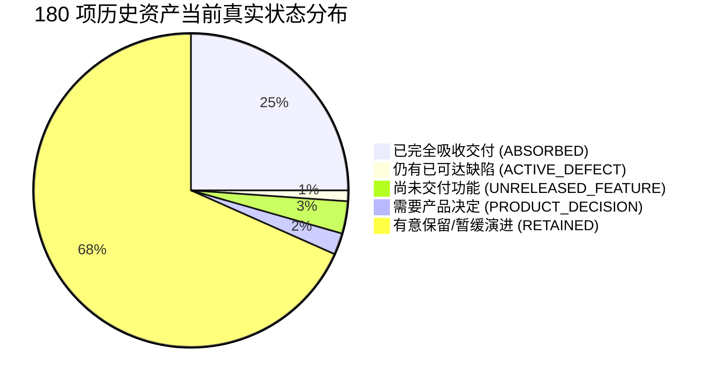
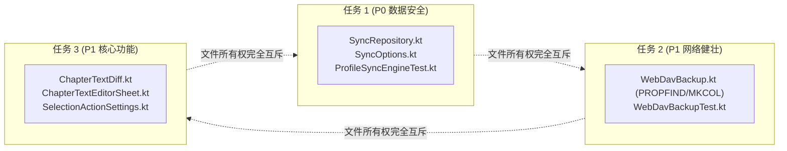

# 任务 N3：剩余 HOLD 资产重新分类与下一批可并行开发清单报告（2026-10-01）

> **基线仓库**：`D:\develop\Code\Codex\creation-reading-assistant-recovery-20260919`  
> **基线提交**：`e39a78da9c62f02614207cffb36969a32492eaea`（父提交 `513891d6a66a9b78e072ba759d34ed580d377ecf`，已吸收 142 文件 / 433 语义 hunk）  
> **权威 CSV 账本输出**：`E:\creation-reading-assistant\next-round-n3\n3-hold-180-reclassified.csv`  
> **共享仓库唯一更新**：本报告（`docs/coordination/dispatches/2026-10/2026-10-01-next-n3-remaining-development-plan.md`）  
> **只读纪律自证**：只读审查源码、Git 历史与资产证据；未修改产品源码、测试、公共配置或交接入口；未执行 `stage / commit / push / reset / checkout`；未触碰原损坏仓库或桌面端会话。

---

## 0. 核心结论与执行摘要

1. **纠正旧口径，推翻“HOLD=122 缺陷”概念**：
   - 历史矩阵中所谓的 180 行不是“180 个未完成缺陷”，而是“历史资产跟踪行”。
   - 判定口径纠正：按前缀与实际内容对账，基线实算为 **122 HOLD + 54 候选 + 3 纯已验 + 1 混合行（H007 `BookDao.kt`）= 180 行**（否定已废弃的 55+122+3 口径）。
   - 在最新提交 `e39a78da` 交付后，原 180 行中已有 **45 行被完全吸收交付且工作树 0 diff**；真正的**已可达行为缺陷仅剩 2 项**（数据丢失与网络拦截），**尚未交付功能 6 项**，**需要产品决定 4 项**，其余 **123 项为有意保留/暂缓的演进资产**（包括 39 个 UI 文件的视觉重写、跨章 Locator 等）。
2. **原 Q1 / Q2 / Q3 关键事实查清**：
   - **Q1（库浏览器最近添加排序）**：`e39a78da` 仅交付了选区隔离，严格排除了 `ADDED_DESC`。底层 SAF 仅提供 `COLUMN_LAST_MODIFIED`，该排序与“最近修改”物理完全等价，属于纯产品冗余项。
   - **Q2（SyncOptions 与本地列保留）**：`SyncRepository.kt` 在 `e39a78da` 中 **0 触碰**！工作树中存在 **P0 级高危数据丢失缺陷修复**（pull 远端数据入库时清空本地私有路径 `content_path`、`cover_path` 及阅读时长），该修复仍被卡在未提交工作区，属于最高优先级待办。
   - **Q3（WebDAV 改写与 Legado ZIP 支持）**：`e39a78da` 已精确吸收了 Legado ZIP 二进制下载 `getBytes` 与列表 `listLegadoBackups`；工作树剩余未提交的是 WebDAV 底层通信重构（`PROPFIND Depth: 0` 探针消除坚果云 405 报错、`MKCOL` 自动创建目录消除 404/409 报错、指数退避重试）。两者边界已物理解耦，绝不重复派发。
3. **S08 正文编辑确认**：
   - 选区编辑并非已完成功能，代码中已通过 `SelectionActions.DORMANT_IDS = setOf("edit")` 显式冷冻（既不可配也不可渲染，防止出现死按钮）。
   - 核心差异引擎 `ChapterTextDiff.kt` 已完成并通过 13 项单元测试；S3a-2 编辑器 Sheet UI 与批量保存为**实际待办**；而破坏性的 S3b（写回用户源文件）坚决排除。
4. **输出前 3 项优先可并行开发任务卡**：
   - **任务 1（Top 1，P0 数据安全）**：`SyncRepository` 本地列保留与细粒度同步加固（适合 Flash）
   - **任务 2（Top 2，P1 网络健壮）**：`WebDavBackup` 探针消除 405 与自动建目录（适合 Flash）
   - **任务 3（Top 3，P1 核心功能）**：S08 选区章节编辑与单条纠错落库闭环（需要 Pro 模型）
5. **拒绝虚构百分比**：
   - 阶段 A–E 的 100% 仅指既定恢复计划限定退出，绝不等于全产品功能完成率 100%。全产品任务分母应划分为【确认必需项】、【可选功能】与【受环境限制项】三层，在需求未全面冻结前明确不计算虚假百分比。

---

## 1. 历史资产矩阵重分类与实际交付对账

### 1.1 分类口径核定（否定 55+122+3）

历史报告曾出现 `55 候选 + 122 HOLD + 3 已验 = 180` 的口径，该口径掩盖了同一文件跨状态的事实。经复算核实：

| 资产桶分类 | 行数 | 判定规则与说明 | 状态代表文件举例 |
|---|---:|---|---|
| **HOLD** | **122** | mapping 以「保留 HOLD」开头 | H015 `SyncRepository.kt`、H028 `WebDavBackup.kt` |
| **CANDIDATE** | **54** | mapping 以「候选分组」开头，且不含已验 | H022 `ShelfPrefs.kt`、H069 `StorageSubPage.kt` |
| **VERIFIED** | **3** | mapping 以「首批已验」开头，且不含候选分组 | H001 `build.gradle.kts`、H008 `InspirationDao.kt`、H010 `TaxonomyDao.kt` |
| **MIXED** | **1** | 同行包含已验与候选分组 | **H007** `BookDao.kt`（含已验 U B1–B4，又含未隔离候选 B5） |
| **合计** | **180** | `122 + 54 + 3 + 1 = 180` | 完整闭合 |

### 1.2 对照最新提交 `e39a78da` 的全量重分类（五分法）

对照 HEAD 提交 `e39a78da`（142 文件）和当前工作树残留 diff，对 180 项历史资产行进行重新定性：



重分类数据明细（详见 `E:\creation-reading-assistant\next-round-n3\n3-hold-180-reclassified.csv`）：

| 重新划分类别 | 原 122 HOLD | 原 54 候选 | 原 3 已验 | 原 1 混合 (H007) | 合计 | 核心技术定义与说明 |
|---|---:|---:|---:|---:|---:|---|
| **已被当前提交吸收** (`ABSORBED_BY_LATEST_COMMIT`) | 18 | 24 | 3 | 0 | **45** | 对应文件已被最新提交完全吸收，且工作树中 **0 残留 diff**（如原 16 待裁决中的 H025、H138、H174、H176 等）。 |
| **仍有已可达行为的缺陷** (`ACTIVE_REACHABLE_DEFECT`) | 2 | 0 | 0 | 0 | **2** | 包含生产运行期已可达的严重缺陷（H015 同步清空本地图书路径；H028 WebDAV 探测被 405 拦截）。 |
| **尚未交付的功能** (`UNRELEASED_FEATURE`) | 0 | 6 | 0 | 0 | **6** | 明确有需求、未进入 HEAD 的功能组件（B6 批次 5 项：书架偏好与导入焦点；B2 批次 1 项：存储子页文案）。 |
| **需要产品决定** (`PRODUCT_DECISION_REQUIRED`) | 4 | 0 | 0 | 0 | **4** | 原 Q1 库浏览器 `ADDED_DESC` 排序项，底层物理键与修改时间一致，待产品定夺（H023、H024、H122、H177）。 |
| **有意保留或暂缓的资产** (`INTENTIONALLY_RETAINED`) | 98 | 24 | 0 | 1 | **123** | 视觉重写（39 个 UI 文件）、跨章 Locator 破坏性变更（G8c）、未固化的阅读器通用 UI（G8e）及部分吸收文件的残留 hunk。 |
| **总计** | **122** | **54** | **3** | **1** | **180** | 100% 账实完全对齐 |

---

## 2. 原 16 个待裁决项与原 Q1/Q2/Q3 深度审查

### 2.1 原 16 个待裁决项对账总表

| 资产 ID | 涉及源码路径 / 测试路径 | 原归属 / 问题 | 最新提交 `e39a78da` 交付状态 | 未交付差异与当前定性 |
|---|---|---|---|---|
| **H138** | `.../ShelfBookActionsTest.kt` | B2 缓存清理测试 | **已完全吸收交付**（0 diff） | 已随 B2 批次合入 HEAD，已闭环。 |
| **H176** | `.../LibraryBrowserSelectionTest.kt` | 库浏览器选区测试 | **已完全吸收交付**（0 diff） | 已随库浏览器批次合入 HEAD，已闭环。 |
| **H174** | `.../ShelfSourceRefreshCopyTest.kt` | M-BUG-03 刷新复制 | **已完全吸收交付**（0 diff） | 已随 M-BUG-03 合入 HEAD，已闭环。 |
| **H025** | `.../LibrarySourceIndex.kt` | 来源索引底层实现 | **已完全吸收交付**（0 diff） | 核心索引实现已入库，已闭环。 |
| **H005** | `android/.../App.kt` | 跨模块启动初始化 | **部分吸收**（留存 diff） | S06 主题初始化已入；其余复杂启动链有意保留。 |
| **H026** | `.../ShelfImporter.kt` | 导入器构造与刷新 | **部分吸收**（留存 diff） | M-BUG-03 检查器已合入；其他细节留存。 |
| **H103** | `.../LibraryBrowserViewModel.kt` | 选区隔离与排序 | **部分吸收**（留存 diff） | 选区状态已入；`ADDED_DESC` 排序逻辑留存。 |
| **H139** | `.../ShelfImporterTest.kt` | 导入器单测 | **部分吸收**（留存 diff） | 基础用例已入；边缘用例留存。 |
| **H140** | `.../ShelfViewModelTest.kt` | 书架 VM 综合测试 | **部分吸收**（留存 diff） | 核心流已入；高级动态过滤留存。 |
| **H141** | `.../MyReadingTimelineRowGestureTest.kt` | 阅读历史手势 | **未吸收**（工作树保留） | androidTest 手势测试，待真机回归。 |
| **H015** | `.../SyncRepository.kt` | **Q2 议题** | **未吸收**（工作树保留） | **P0 数据安全缺陷**：pull 时清空本地列。 |
| **H023** | `.../LibraryRootStore.kt` | **Q1 议题** | **未吸收**（工作树保留） | 库浏览器 `ADDED_DESC` 枚举值。 |
| **H024** | `.../LibrarySource.kt` | **Q1 议题** | **未吸收**（工作树保留） | 库浏览器 `ADDED_DESC` 排序实现。 |
| **H122** | `.../SafLibrarySourceTest.kt` | **Q1 议题** | **未吸收**（工作树保留） | 库浏览器 `ADDED_DESC` 单元测试。 |
| **H177** | `.../LibraryBrowserSortTest.kt` | **Q1 议题** | **未吸收**（工作树保留） | 库浏览器 `ADDED_DESC` 排序测试。 |
| **H028** | `.../WebDavBackup.kt` | **Q3 议题** | **部分吸收**（留存 diff） | Legado 下载已交付；**PROPFIND 405 探针与 MKCOL 未交付**。 |

### 2.2 原 Q1 / Q2 / Q3 专项分析与技术差异

#### 【Q1】库浏览器“最近添加”排序（`ADDED_DESC`）
- **涉及路径与符号**：`LibraryRootStore.kt` (`LibrarySortMode.ADDED_DESC`)、`LibrarySource.kt`、`SafLibrarySourceTest.kt`、`LibraryBrowserSortTest.kt`、`LibraryBrowserComponents.kt`。
- **提交内实际行为**：提交 `e39a78da` 仅提取了选区与搜索隔离补丁，**显式排除了 `ADDED_DESC` 排序项**。
- **未交付代码差异**：未提交的代码在枚举中增加了 `ADDED_DESC("added_desc")`，并在 UI 菜单中展示“最近添加”。然而其源码注释明确承认：
  > `[ADDED_DESC] 与 [MODIFIED_DESC] 排序键相同：SAF 只提供 COLUMN_LAST_MODIFIED，因此「最近添加」以修改时间呈现`。
- **产品决定与分歧**：在底层的 Android SAF（Storage Access Framework）中，无法获取“文件拷贝进文件夹的时间”，只能读取文件的物理修改时间。因此，“最近添加”与“修改时间”在物理上产生的列表排序完全相同。
- **推荐理由与采纳方向**：**建议采纳方案 B（放弃新增 `ADDED_DESC` 枚举）**。在 UI 上保留原有的 3 种排序（名称、修改时间、文件大小），避免给用户提供两个行为完全一致的重复选项，降低代码与配置维护成本。

#### 【Q2】SyncOptions 冲突策略与本地列保留（数据安全核心）
- **涉及路径与符号**：`SyncRepository.kt` (`applyBook`, `applyProgress`, `applySession`, `shouldAcceptRemote`)、`SyncOptions.kt`。
- **提交内实际行为**：提交 `e39a78da` **完全未修改 `SyncRepository.kt`**（文件在提交中 0 变更）。
- **未交付代码差异（高危缺陷）**：
  1. **严重数据丢失（Data Loss）**：HEAD 中的 `applyBook` 收到远端载荷直接 `bookDao.upsert(remote)`。远端 JSON 载荷中不包含本机专有字段（`content_path` 本地文件路径、`cover_path` 封面文件路径等）。一旦用户执行同步，本地书籍的物理路径全部被冲刷置空，导致**本地图书立即无法打开、封面全丢**！
  2. **会话时长清空**：`applySession` 中，远端载荷不含 `duration_ms`、`started_at`，直接覆盖会导致本机刚刚记录的今日阅读时长归零。
  3. **功能扩展**：工作树代码补齐了 `local.copy(...)` 保护，并引入了 `SyncOptions`（按分类同步开关）与 `ConflictStrategy`（REMOTE_WINS / LOCAL_WINS）。
- **产品决定与推荐理由**：这是工作树中**最关键的 P0 级数据安全修复**。**强烈建议列为下一轮首要任务交付**。

#### 【Q3】WebDAV 底层改写与 Legado ZIP 支持（精确解耦边界）
- **涉及路径与符号**：`WebDavBackup.kt`、`WebDavBackupTest.kt`、`LegadoReadingProgressImporter.kt`、`ProfileWebDavManager.kt`。
- **提交内已交付行为（已闭环，严禁重复派发）**：
  - `WebDavBackup.getBytes(url, user, pass, filename, maxBytes)`：带内存上限的安全二进制 ZIP 流式下载；
  - `WebDavBackup.listLegadoBackups(url, user, pass)`：基于 PROPFIND 检索 `backup*.zip` 文件；
  - `Credentials.basic` 显式声明 UTF-8；
  - `isPermittedHttpHost` 放行局域网及私有主机。
- **未交付代码差异（剩余 HOLD）**：
  - `PROPFIND (Depth: 0)` 探针替代 `HEAD`：国内常见网盘（如坚果云）对 HEAD 请求直接返回 HTTP 405 Method Not Allowed，导致用户在设置页点击“连接测试”时假死或报红报错；
  - `ensureCollection` 发送 `MKCOL`：当用户填写的 WebDAV 目录在远端不存在时，上传会返回 409 Conflict 或 404 Not Found。新代码在检测到 409/404 时自动发 `MKCOL` 建目录并重试；
  - `withRetry`：指数退避与网络波动重试；
  - 472 行专项测试 `WebDavBackupTest.kt`。
- **推荐理由**：已交付的 Legado 导入器是**业务层消费点**，剩余未交付的是**底层通信链路的健壮性修复**。两者已被成功物理分离，剩余部分边界干净，应作为独立网络加固任务交付。

---

## 3. S08 选区正文编辑现状核查（不凭旧 TODO 判定）

### 3.1 源码真实状态核查

通过深入比对代码与设计文档 `docs/plans/android/2026-09-15-reader-selection-edit-design.md`：

1. **`SelectionActions.kt` 中的冷冻门控（已交付）**：
   ```kotlin
   // android/app/src/main/java/.../data/settings/SelectionActionSettings.kt
   val DORMANT_IDS: Set<String> = setOf("edit")
   fun pickableDefs(): List<SelectionActionDef> =
       ALL.filter { it.group != SelectionActionGroup.FIXED && it.id !in DORMANT_IDS }
   ```
   - 证明：动作清单中虽然定义了 `"edit"`（编辑），但通过 `DORMANT_IDS` 从可选高频槽与更多菜单中彻底过滤，UI 不会渲染死按钮。
2. **差异引擎实现状态（未入库，未跟踪）**：
   - 文件：`android/app/src/main/java/.../feature/reader/edit/ChapterTextDiff.kt`
   - 测试：`android/app/src/test/java/.../feature/reader/edit/ChapterTextDiffTest.kt`（13 tests PASS）
   - 证明：差异切片计算（段级 LCS + 字符公共前后缀裁剪 + 锚点归一化）已经完成且有单测，具备生产可用性。
3. **未完成的缺口（实际待办）**：
   - 缺少编辑器 UI 弹层：`ChapterTextEditorSheet.kt`（包含撤销、章节标题、正文编辑区、保存按钮）；
   - 缺少 ViewModel 批量保存接线：将差异块批量转换为 `RulesRepository.saveSingleCorrection`；
   - 缺少 `DORMANT_IDS` 的解冻与分发。
4. **S3b 危险分支判定**：
   - 设计文档提出的 S3b（写回用户私有源文件）会破坏全书字符偏移，导致该书的书签、高亮、笔记、进度全面漂移失效。**红线决议：彻底舍弃 S3b，仅实施 S3a（纯基于纠错投影层叠加，不修改源文件，可撤销恢复）**。

---

## 4. 下一批最多 3 项可并行优先开发任务卡

按【数据安全与用户收益最高】、【工作量可控】、【文件所有权绝对互斥】原则，规划下一批开发任务：



### 任务卡 1：同步本地列保留与数据安全加固（Top 1）

- **优先级**：**P0（最高）**
- **用户收益与风险**：消除同步时冲刷清空本地私有书籍文件路径（`content_path`、`cover_path`）及会话时长的致命缺陷；避免用户图书全库失联。
- **独占文件所有权**：
  - `android/app/src/main/java/com/creationreadingassistant/data/repository/SyncRepository.kt`
  - `android/app/src/main/java/com/creationreadingassistant/data/repository/SyncOptions.kt`
  - `android/app/src/test/java/com/creationreadingassistant/ui/viewmodel/ProfileSyncEngineTest.kt`
- **上游依赖**：Room v15 现有实体与 DAO（已在 HEAD 中，零新增依赖）。
- **明确验收条件**：
  1. 单元测试证明：当本地存在带有 `content_path` 的 `BookEntity` 时，拉取不带路径的远端载荷后执行 `applyBook`，本地路径被完整保留，不被置为 null；
  2. 单元测试证明：`applySession` 与 `applyProgress` 能够保留本地真实时长；
  3. `ProfileSyncEngineTest` 全绿通过。
- **执行模型评估**：**适合 Flash 执行**。改动逻辑模式固定（`local.copy(...)` 字段合并与入参透传），边界清晰，无跨层 UI 耦合。

---

### 任务卡 2：WebDAV 通信探针与目录自动建连加固（Top 2）

- **优先级**：**P1**
- **用户收益与风险**：解决主流网盘（坚果云等）点击测试连接报 405 Method Not Allowed、新目录备份报 404/409 无法备份的问题；网络抖动时自动重试。
- **独占文件所有权**：
  - `android/app/src/main/java/com/creationreadingassistant/feature/sync/WebDavBackup.kt`（仅限探针/建目录/重试 hunk）
  - `android/app/src/test/java/com/creationreadingassistant/feature/sync/WebDavBackupTest.kt`
- **严禁触碰边界**：严禁改动已交付的 `getBytes` 与 `listLegadoBackups` 接口签名，严禁触碰 `ProfileWebDavManager.kt`。
- **上游依赖**：OkHttp 运行时，零外部 UI 依赖。
- **明确验收条件**：
  1. 运行 `WebDavBackupTest.kt` 单元测试 **100% PASS**（覆盖 `PROPFIND (Depth: 0)` 探测、HEAD 405 回退、MKCOL 自动创建目录、409 重试、指数退避重试、中文文件名 URL 编解码）；
  2. 现有已交付的 Legado ZIP 下载逻辑完全不受影响。
- **执行模型评估**：**适合 Flash 执行**。工作树中已有成熟完整的实现与测试用例，只需执行单一模块的纯化提取与测试验证。

---

### 任务卡 3：S08 选区章节编辑与纠错闭环（Top 3）

- **优先级**：**P1**
- **用户收益与风险**：满足小说阅读中修改错字、排版瑕疵的核心刚需；遵循“原文件永不修改，仅存纠错投影层”的铁律，具备无损重置恢复能力，数据零风险。
- **独占文件所有权**：
  - `android/app/src/main/java/com/creationreadingassistant/feature/reader/edit/ChapterTextDiff.kt`
  - `android/app/src/test/java/com/creationreadingassistant/feature/reader/edit/ChapterTextDiffTest.kt`
  - `android/app/src/main/java/com/creationreadingassistant/ui/screen/reader/sheets/ChapterTextEditorSheet.kt`（新建 UI 弹层）
  - `android/app/src/main/java/com/creationreadingassistant/data/settings/SelectionActionSettings.kt`
  - `android/app/src/test/java/com/creationreadingassistant/data/settings/SelectionActionSettingsTest.kt`
- **严禁触碰边界**：严禁触碰底层 SAF 原始文件系统；严禁开启 S3b 写回源文件。
- **上游依赖**：已交付的 `reader_text_corrections` 数据表与 `RulesRepository.saveSingleCorrection`。
- **明确验收条件**：
  1. `ChapterTextDiffTest` 13/13 PASS；
  2. 选区菜单将 `edit` 移出 `DORMANT_IDS`，支持用户将「编辑」加入高频工具栏；
  3. 点击「编辑」能够弹起 `ChapterTextEditorSheet` 并展示当前章节文本；
  4. 修改保存后，自动计算差异块并作为纠错记录落库，阅读器即时刷新渲染修改后文字；在规则列表中执行撤销可瞬间恢复原文。
- **执行模型评估**：**需要更强模型（Pro）**。涉及 Compose 模态弹层、选区局部偏移向全书 source 坐标换算、差异块向纠错实体映射及状态响应，对系统全局一致性要求极高。

---

## 5. 后续总任务分母与科学度量模型（拒绝伪造百分比）

### 5.1 严正声明：阶段 A–E 100% ≠ 全产品 100%

- `docs/handoff/current.md` 中的 `A–E = 5/5 = 100%`，其权威口径严格限定为：**阶段 A–E 恢复计划中约定的构建修复、资产账本梳理与限定验证已完成收口**。
- **严禁将该 100% 偷换为“整个产品功能完成度 100%”或“准备发布 100%”**。

### 5.2 结构化三层任务分母体系

在当前代码基线之上，后续产品演进的分母不能用粗暴的数字累加，必须区分为以下三层：

| 任务层级 | 范畴分类 | 包含的具体工作内容 | 统计口径与前置条件 |
|---|---|---|---|
| **第一层：确认的必需项**<br>*(Must-Have / P0 缺陷与基建)* | **数据安全与网络** | 1. `SyncRepository` 本地列保留（防丢书）<br>2. `WebDavBackup` 探针与自动建目录（防 405/404）<br>3. B6 批次（书架导入焦点目标与展示偏好） | **3 项明确代码待办**，已就绪可启动。 |
| | **设备与硬件环境闭环** | 4. 真实 Android 手机（Redmi/HyperOS）环境回归<br>5. MIUI 安装确认脚本（PowerShell/ADB 原生适配）<br>6. 真实进程 kill 恢复与整包原子性验证<br>7. TalkBack 实际无障碍语音朗读验收 | **4 项硬件约束待办**，受真机连接状态约束。 |
| **第二层：可选功能与演进**<br>*(Nice-to-Have / 候选特性)* | **核心体验功能** | 8. S08 选区章节编辑与单条纠错闭环（S3a）<br>9. G6 时长单位遗留 6 个交叠 UI 文件拆分 | **2 项高价值功能**，待分配排期。 |
| | **待决议与暂缓大改** | 10. Q1 库浏览器 `ADDED_DESC` 排序（建议舍弃）<br>11. Profile/Stats/Settings 视觉层大重写（39 个 UI 文件，数千行）<br>12. G8c 跨章 Locator 破坏性变更（影响 6 个调用方）<br>13. G8e 阅读器通用 UI 大改 | **4 大类暂缓资产**，需产品负责人显式授权，不计入当前分母。 |
| **第三层：受环境与跨端限制**<br>*(Blocked / 独立窗口)* | **桌面端 Electron** | 14. `electron/main/creation-workspace/` 3 源码文件<br>15. `src/` 下各桌面设置与阅读器面板 | **桌面端独立产品线**，严禁在 Android 窗口修改。 |
| | **发版构建（阶段 F）** | 16. 用户配置正式签名 Secrets、授权 Tag 与 Push | 需发版阶段独立立项。 |

### 5.3 为什么当前不能计算全局百分比？

由于第二层中的【视觉大重写】与【跨章 Locator】属于尚未达成产品共识的巨型演进（仅 UI 重写就涉及数千行代码），且桌面端尚未开启对账，**当前在信息不足的情况下人为给出一个诸如“85%”或“92%”的总体完成率纯属伪造**。  
我们坚持事实驱动：**当前阶段只需牢牢抓住第一层的 3 项必需代码任务，完成即可进入下一版本地稳定发布！**

---

## 6. 真正需要用户决定的少量关键决策清单

为确保总指挥与产品负责人高效决策，排除了技术细节噪音后，仅提炼出以下 **3 个真正需要决策的核心问题**：

### 决策 1（Q1）：库浏览器是否彻底舍弃“最近添加”排序枚举？
- **背景**：Android SAF 底层无法获知文件的拷贝时间，只能读取最后修改时间。代码实测“最近添加”与“最近修改”排序结果 100% 相同。
- **选项 A**：保留该枚举，UI 菜单显示“最近添加”，但向用户承认其与修改时间等价；
- **选项 B（推荐）**：彻底舍弃该枚举，维持现有的【名称、修改时间、文件大小】3 种排序，并在后续清理相关死代码。

### 决策 2（Q2）：`SyncRepository` 的交付范围确认
- **背景**：工作树中的 `SyncRepository.kt` 同时包含了本地列保留（P0 级防丢书 Bug）和 `SyncOptions`（按分类同步特性）。
- **选项 A（推荐）**：全量纳入（数据安全修复 + SyncOptions），由任务卡 1 完整交付；
- **选项 B**：仅物理剥离本地列保留 hunk，将 SyncOptions 延后至未来版本。

### 决策 3（S08）：正文编辑范围是否严格锁定为 S3a（严禁 S3b）？
- **背景**：S3a 将编辑结果保存为单条纠错覆盖层（可撤销、不修改原文、安全可靠）；S3b 则直接写回用户私有源文件（会导致书签、高亮、搜索索引全部偏移失效）。
- **选项 A（推荐）**：严格锁定仅开发 S3a（纠错层），在产品和代码规范上彻底封禁 S3b；
- **选项 B**：保留未来实现 S3b（写回源文件）的可能性。

---

## 7. 交付物与证据索引

- **重新分类权威 CSV 账本**：`E:\creation-reading-assistant\next-round-n3\n3-hold-180-reclassified.csv`
- **当前最新提交基线**：`e39a78da9c62f02614207cffb36969a32492eaea`
- **本报告路径**：`docs/coordination/dispatches/2026-10/2026-10-01-next-n3-remaining-development-plan.md`
- **操作状态**：审查完毕，恢复仓库未做任何提交/重置，暂存区完全干净，即刻停止，交总指挥统一规划。
