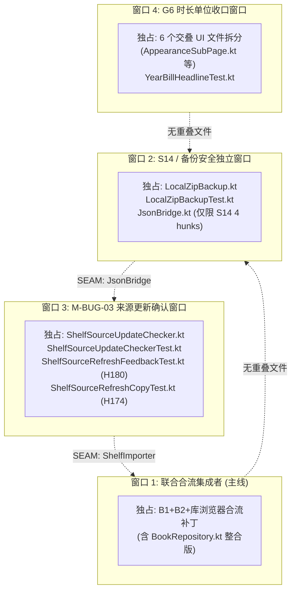

# 阶段 E：资产与 HOLD 归属只读审查及综合对账报告（2026-09-30）

- **审查角色**：Antigravity（只读审查员）
- **工作仓库**：`D:\develop\Code\Codex\creation-reading-assistant-recovery-20260919`（分支 `codex/recover-worktree-20260920`）
- **当前 HEAD**：`513891d6a66a9b78e072ba759d34ed580d377ecf`（包含首批提交 A `209ec8a` G0+U 和提交 B `513891d` G2+runner）
- **暂存区状态**：`git diff --cached` 无任何输出，**暂存区完全为空**
- **操作纪律**：只读审查，未修改任何产品源码、测试代码或公共配置；未操作 ADB/MuMu；未触碰原仓库、实体手机或正式书库；未触碰 E 盘其他窗口工作目录（G6、S14 等）；未执行 `stage / commit / push / reset / checkout`。
- **唯一可写共享文件**：本报告（`docs/coordination/legacy-stages/2026-09/2026-09-30-stage-e-asset-hold-reconciliation.md`）。

---

## 0. 核心核查结论先行

1. **基线与状态核实**：
   - 当前恢复仓库 HEAD 为 `513891d6a66a9b78e072ba759d34ed580d377ecf`，暂存区保持完全干净（Clean staging area）。
   - 工作树既有修改全部完整保留，未发生重置或丢失。
2. **矩阵与 HOLD 行数对账**：
   - **原始全覆盖矩阵**（`stage-e-full-coverage-matrix.csv`）：基准行数 **376 行**（239 M + 137 ??）。
   - **初始 HOLD 行数**：**180 行**（`H001`–`H180`，`group=HOLD`）。
   - **86 行未映射归属收敛**：经 2026-09-29 映射后，86 行全部归入具体批次或保留 HOLD（55 行归入候选批次但未隔离编译，53 行保留 HOLD，1 行首批已验 U T1–T4）。
   - **保留 HOLD 行数**：共 **122 行**（包含 §2.9 已定义 HOLD 桶 37 行、仍待裁决 16 行、其他暂缓 69 行）。
3. **四项核心疑难与边界勘误复核**：
   - **M-BUG-03 两个误排新文件**：`ShelfSourceUpdateChecker.kt` 与 `ShelfSourceUpdateCheckerTest.kt` 原矩阵中误标 `EXCLUDED`，实为来源更新确认与 `ShelfImporter` 的核心硬依赖，已更正为 M-BUG-03 候选（已在 A 候选 68 JVM PASS 中验证）。
   - **H180 错归属**：`ShelfSourceRefreshFeedbackTest.kt` 在 180 行表中标为 `B2`，实测调用 M-BUG-03 来源刷新汇总机制，已更正为 M-BUG-03 候选（已在 A 候选 14/14 PASS 中验证）。
   - **G6 完整 22+5 范围**：原集成决策包粗列 7 个独立文件；符号穷举核实实际涉及 **22 个生产文件 + 5 个测试文件 = 27 个文件**。E 盘已分层验证 16/22 生产 + 4/5 测试（25/25 JVM PASS），剩余 6 个高交叠 UI 文件待拆分。
   - **S14 / R3 共用 `JsonBridge.kt` 边界**：536 行源码中成功精确分离出 S14 的 **4 个核心 hunk**（`ImportMergeResult` + 回调 + 收集），已验证 34/34 JVM PASS；完全排除并保留 HOLD 了 R3 相关的 3 个 DTO、DAO 注入及合并逻辑。
4. **阶段 E 进度口径**：当前阶段 E 仍处于 **4/5（80%）**。尽管各隔离候选在 JVM/模拟器上取得局部通过，但尚未完成全量资产收口与新本地提交授权。

---

## 1. 矩阵计数体系与可复算差异说明

### 1.1 核心矩阵演进与计数口径

| 矩阵标识 | 物理行数 / 规格 | 说明与基准状态 |
|---|---|---|
| **原始全量覆盖矩阵** (`stage-e-full-coverage-matrix.csv`) | **376 行**数据行 + 1 表头行 | 对应 HEAD `5aed593` 时点的 `git status --porcelain -uall -- android/`（239 M + 137 ??）。 |
| **初始 HOLD 矩阵** (`hold-180-row-mapping.csv`) | **180 行**数据行 (`H001`–`H180`) | 提取 376 行中 `group=HOLD` 的 180 项，初始有 86 行标为 `mapping=未映射`。 |
| **86 行归属后矩阵** (`hold-180-row-mapping-updated.csv`) | **180 行**数据行 (`H001`–`H180`) | 86 行全部分配：候选分组 55 行、保留 HOLD 122 行（含待裁决 16 行）、首批已验 3 行。 |
| **三行勘误清单** (`matrix-corrections-20260930.csv`) | **3 行**更正数据 | 纠正 2 个 `EXCLUDED` 误排文件与 1 个 H180 错归属项，原矩阵保持只读不覆盖。 |

### 1.2 计数差异与分类对账

1. **376 行与 180 行的关系**：
   - 376 行 = 首批候选（G0/U/G2 等，约 48 行）+ 初始已规划批次（B1–B8 约 112 行）+ 粗标 `EXCLUDED`（36 行）+ **HOLD 矩阵 180 行**。
   - 180 行 HOLD 是从 376 行中挑出的当时“跨模块混合、依赖未清或暂缓”的行。
2. **180 行中 122 行保留 HOLD 的构成**：
   - 122 行保留 HOLD = **§2.9 已定义 HOLD 桶（37 行）** + **§4.2 仍待裁决项（16 行）** + **前期已明确暂缓项（69 行）**。
   - 180 行中的其余 58 行 = **候选分组（55 行）** + **首批已验（3 行）**。
   - 计算：`55 + 122 + 3 = 180`，逻辑严密闭合。
3. **16 行仍待裁决项的分类构成**：
   - **已裁决（2 行）**：H138（B2 缓存清理测试）、H176（库浏览器选择边界测试）。
   - **仍待证据 / 待拆分（8 行）**：H005 (`App.kt`)、H025 (`LibrarySourceIndex.kt`)、H026 (`ShelfImporter.kt`)、H103 (`LibraryBrowserViewModel.kt`)、H139 (`ShelfImporterTest.kt`)、H140 (`ShelfViewModelTest.kt`)、H141 (`MyReadingTimelineRowGestureTest.kt`)、H174 (`ShelfSourceRefreshCopyTest.kt`)。
   - **需要产品决定（6 行）**：H015 (`SyncRepository.kt`)、H023 (`LibraryRootStore.kt`)、H024 (`LibrarySource.kt`)、H028 (`WebDavBackup.kt`)、H122 (`SafLibrarySourceTest.kt`)、H177 (`LibraryBrowserSortTest.kt`)。
   - 计算：`2 + 8 + 6 = 16`，逐项对应。

---

## 2. 四大关键复核项专项报告

### 2.1 M-BUG-03 两个误排新文件与 H180 错归属

- **误排新文件 1**：`android/app/src/main/java/com/creationreadingassistant/feature/library/ShelfSourceUpdateChecker.kt`
- **误排新文件 2**：`android/app/src/test/java/com/creationreadingassistant/feature/library/ShelfSourceUpdateCheckerTest.kt`
  - **审查事实**：在 376 行总矩阵中被错误列为 `EXCLUDED`。然而，代码调用链分析显示，`ShelfImporter` 与 `ShelfViewModel` 的构造器直接注入并依赖 `ShelfSourceUpdateChecker`；一旦排除，主源码与单元测试均无法编译。
  - **最新证据**：E 盘 `stage-e-mbug03-isolated-20260929` 中，候选 A 纳入两文件后编译成功，定向测试 68/68 PASS（其中 `ShelfSourceUpdateCheckerTest` 6/6 PASS）。
  - **结论**：两文件正式撤销 `EXCLUDED` 标签，确认为 M-BUG-03 候选不可分割的核心组件。
- **H180 错归属**：`android/app/src/test/java/com/creationreadingassistant/ui/viewmodel/ShelfSourceRefreshFeedbackTest.kt`
  - **审查事实**：在 `hold-180-row-mapping-updated.csv` 中被归入 `B2 candidate`（S04 缓存清理与来源替换）。经查阅代码，该测试全部 14 个用例均在断言 `summarizeSourceRefreshFailureReason` 和 `buildSourceRefreshSummary`，完全属于 M-BUG-03 来源刷新文案与反馈机制，与 H174 互为姊妹用例，与 B2 无语义关联。
  - **最新证据**：候选 A 中运行 14/14 PASS。勘误清单（`matrix-corrections-20260930.csv`，SHA-256 `dd3597e3...`）已登记修正。
  - **结论**：H180 正式由 B2 更正为 M-BUG-03 候选测试。

### 2.2 G6 时长单位切换完整 22+5 范围复核

- **原边界缺陷**：集成决策包 §2.3 仅粗略列出 7 个独立文件，无法实现声称的“全局时长单位切换”。
- **全仓符号引用核查**：在 `android/app/src/main/java` 中搜索 `LocalDurationUnit | DurationPrefs | DurationUnit`，实际命中 **22 个生产文件**；测试目录命中 **5 个关联测试**，合计 **27 个文件**：
  1. **根部契约与注入（4 生产 + 3 测试）**：
     - 生产：`MainActivity.kt`、`data/settings/DurationPrefs.kt`、`ui/util/DurationDisplay.kt`、`ui/util/TimeUtils.kt`
     - 测试：`data/settings/DurationPrefsTest.kt`、`data/settings/DurationUnitTest.kt`、`ui/util/TimeUtilsTest.kt`
  2. **首页与阅读历史（4 生产 + 1 测试）**：
     - 生产：`HomeMetricsSection.kt`、`HomeReadingArchiveSection.kt`、`HomeCompletedScreen.kt`、`MyReadingScreen.kt`
     - 测试：`HomeReadingArchiveSectionTest.kt`
  3. **个人中心与设置（3 生产）**：
     - 生产：`AppearanceSubPage.kt`、`ProfileHomeScreen.kt`、`ReadingArchiveSection.kt`
  4. **阅读器与书架展示（5 生产）**：
     - 生产：`ReaderHelpers.kt`、`ReaderBookInfoSheet.kt`、`ReaderProgressSheet.kt`、`BookDetailStatsSection.kt`、`ShelfUtils.kt`
  5. **统计图表模块（6 生产 + 1 测试）**：
     - 生产：`StatsPage.kt`、`CreationSection.kt`、`HeatmapSection.kt`、`SummaryGroup.kt`、`TrendSection.kt`、`YearBillHeroCard.kt`
     - 测试：`YearBillHeadlineTest.kt`
- **最新隔离验证状态**（`stage-e-g6-partial-isolation.md`）：
  - E 盘已完成四层隔离候选构建（core, consumers1, consumers2, consumers3），覆盖 **16/22 生产 + 4/5 测试**，定向 JVM **25/25 PASS**（0 fail/error/skip）。
  - **剩余 6 个高交叠 UI 生产文件**（`AppearanceSubPage.kt`、`ProfileHomeScreen.kt`、`CreationSection.kt`、`HeatmapSection.kt`、`SummaryGroup.kt`、`YearBillHeroCard.kt`）及 `YearBillHeadlineTest.kt` 深度交织了统计改版与设置大重写，**当前维持 HOLD**，待手工拆分。

### 2.3 S14 / R3 共用 `JsonBridge.kt` 的 Hunk 边界核实

- **冲突背景**：`JsonBridge.kt`（536 行）在工作树中同时修改了 S14（本地备份解压安全）与 R3/S04-5（来源引用与阅读器纠错规则同步）。此前报告曾误判两组改动强耦合。
- **物理解耦实测**（来自 `2026-09-30-stage-e-s14-isolation.md`）：
  - **S14 仅需 4 个精确 hunk**：
    - `Hunk 1`：声明 `ImportMergeResult(acceptedBookIds: Set<String>, skippedBookContentPaths: List<String>)` 数据类。
    - `Hunk 2`：`importFromString` 签名扩展 `onMergeResult: (ImportMergeResult) -> Unit = {}`。
    - `Hunk 3`：书籍事务内收集 `acceptedBookIds` 与本地较新书籍的 `skippedBookContentPaths`。
    - `Hunk 4`：事务提交成功后执行 `onMergeResult(...)` 回调。
  - **完全排除并保留 HOLD 的 R3 / S04-5 改动**：
    - `SourceRefExport`、`TextRuleExport`、`CorrectionExport` 3 个数据传输对象。
    - `LocalExport` 增加 `library_source_refs`、`reader_text_rules`、`reader_text_corrections` 序列化字段。
    - `JsonBridge` 构造器注入 `sourceRefDao`、`textRuleDao`、`correctionDao` 3 个 DAO 参数。
    - `exportToString` 与 `importFromString` 中对应的增删改查业务逻辑。
  - **验证结果**：仅提取上述 4 个 S14 hunk 应用到 HEAD 基线后，`:app:compileDebugKotlin` 成功，`LocalZipBackupTest` 34/34 PASS。证明两组改动完全可物理解耦，R3 部分安全保留在 HOLD。

---

## 3. 全量资产分类清单：已归属 / 仍 HOLD / 需要产品决定

### 3.1 已归属批次清单（已具备明确批次边界，列明验证状态）

*注：此处的“已归属”指归属逻辑明确、包含确定文件/hunk，绝不代表可直接 `git commit`。*

| 批次标识 | 功能主题与核心范围 | 包含关键文件 / Hunk | 当前验证状态 | 下一动作 |
|---|---|---|---|---|
| **首批 G0+U+G2** | Room v15 迁移 + 父表 `@Upsert` + qahost 测试基建 | `AppDatabase.kt`, `SearchTermDao.kt`(hunk 5), `BookDao.kt`(B1–B4), `CraIsolatedTestRunner.kt` 等 14 文件 | **已提交到本地** (`209ec8a` → `513891d`)；MuMu 8/8 PASS | 保持 HEAD，待后续批次合流 |
| **B1 批次** | S03 搜索索引并发协调与孤儿回收 | `SearchIndexRepository.kt`, `SearchIndexScheduler.kt`, `SearchIndexBookRefreshCoordinator.kt`, `SearchTermDao.kt`(hunk 6), `BookRepository.kt`(S03 hunks) | E 盘隔离编译 EXIT 0；JVM **75/75 PASS** | 待与 B2/库浏览器合流联合提交 |
| **B2 批次** | S04 来源替换与缓存安全清理 | `BookRepository.kt`(S04 hunks), `BookResidueSafeCleanupTest.kt`, `StorageSubPage.kt`(文案 hunk), H138 (`ShelfBookActionsTest.kt`) | E 盘隔离编译 EXIT 0；JVM **76/76 PASS**（含 filesDir 桩） | 待与 B1/库浏览器合流联合提交 |
| **库浏览器选择边界** | LibraryBrowser 搜索与选区状态隔离 | `LibraryBrowserViewModel.kt`(搜索选择 hunk), H176 (`LibraryBrowserSelectionTest.kt`) | E 盘隔离编译 EXIT 0；JVM **29/29 PASS** | 待联合提交；严格排除 `ADDED_DESC` |
| **联合候选 B1+B2+库浏览器** | B1 + B2 + 库浏览器三合一整合候选 | 上述文件独占整合版（补齐 filesDir 与 Coordinator 接缝） | JVM **167/167 PASS**；MuMu qahost **11/11 PASS**，53 文件前后对账 0 差异 | 待用户授权下一本地提交 |
| **S06 批次** | 启动主题镜像防闪烁 | `SettingsStore.kt`(BootMirror), `ThemeResolver.kt`, `MainActivity.kt`(S06 hunks), `App.kt`(主题初始化) | E 盘隔离编译 EXIT 0；JVM **13/13 PASS**；MuMu 逐帧无闪烁 | 保持独立隔离，等待与 G6 协同 |
| **S14 批次** | ZIP 备份恢复安全与文件原子保护 | `LocalZipBackup.kt`, `JsonBridge.kt`(S14 4 hunks), `LocalZipBackupTest.kt` | E 盘隔离编译 EXIT 0；JVM **34/34 PASS**（含 W5/W6 判别用例） | 保持独立隔离，严禁带入 R3 |
| **M-BUG-03 候选** | 来源更新确认机制 | `ShelfSourceUpdateChecker.kt`, `ShelfSourceUpdateCheckerTest.kt`, H180, H174, `ShelfImporter.kt`(M-BUG-03 hunk) | 候选 A 编译 EXIT 0；JVM **68/68 PASS**；候选 B/C 接缝通过 | SAF/UI 与 MuMu 端到端未跑，待设备验收 |
| **G6 分层候选** | 时长单位全局切换（核心与主要展示层） | 16 个生产文件（`DurationPrefs.kt`, `TimeUtils.kt` 等）+ 4 个测试文件 | 分层候选四层全部编译 EXIT 0；JVM **25/25 PASS** | 待余下 6 个 UI 文件拆分后收拢 |

---

### 3.2 仍必须严格保持 HOLD 的清单（85 行 + 跨批次混合文件）

以下资产因跨组高交叠、依赖底层未就绪、缺乏产品合同或改动过大，**一律保持 HOLD，不得提前合入**：

| HOLD 类别 / 资产 | 涉及关键文件 | 保持 HOLD 的根本理由与技术阻断点 | 下一处置动作 |
|---|---|---|---|
| **待拆分 8 行（来自 16 行待裁决）** | `App.kt` (H005), `LibrarySourceIndex.kt` (H025), `ShelfImporter.kt` (H026), `LibraryBrowserViewModel.kt` (H103), `ShelfImporterTest.kt` (H139), `ShelfViewModelTest.kt` (H140), `MyReadingTimelineRowGestureTest.kt` (H141), `ShelfSourceRefreshCopyTest.kt` (H174) | 跨 3 至 5 个功能域（如 NBB/M-BUG-03/S04/B1），单文件内多个 hunk 严重纠缠，Git 无法物理切分，缺少手工拆分补丁。 | 待单一集成者逐 hunk 进行纯化提取并做单文件隔离编译。 |
| **G6 遗留 6 个交叠 UI 文件** | `AppearanceSubPage.kt`, `ProfileHomeScreen.kt`, `CreationSection.kt`, `HeatmapSection.kt`, `SummaryGroup.kt`, `YearBillHeroCard.kt`, `YearBillHeadlineTest.kt` | 时长单位调用与大型 UI 页面改版、年度账单重构代码交织，直接带入会导致未授权的大规模改版混入。 | 在 G6 核心稳定后，手工剥离仅限时长展示的精确行。 |
| **G8c 跨章 Locator 契约** | `LocatorBuilder.kt`, `LocatorCodec.kt`, `EpubRepository.kt`(H8) | `LocatorCodec.encode` 由 `Int` 改为 `Int?` 破坏了既有公共接口，波及 6 个 UI 调用方，无产品合同支持。 | 严格保持 HOLD，禁止合流。 |
| **G8e 阅读器通用 UI** | 58 个 reader UI 修改/新增文件（如 `ReaderBottomActions.kt` 等） | 依赖底层 G8a 分页重构与 G8c 契约，跨层依赖严重，底层未固化前强合必然引发大面积编译与测试崩溃。 | 阅读器底层稳定后串行分拆。 |
| **Reader 设置覆盖与选区动作** | `SettingsStore.kt`（余下 22 hunks）, `PerBookSettingsStore.kt`, `SelectionActionSettings.kt` | 包含单书独立设置覆写与未完全接线的选区弹窗动作，尚无清晰的功能测试覆盖。 | 建立专项测试后再行规划。 |
| **Profile / Stats 大重写** | `ProfileHomeScreen.kt`（44 hunks）, `GoalSubPage.kt`（73 hunks）, `StorageSubPage.kt` 等 39 个 UI 文件 | 属于非核心体验的视觉层全面重写，改动量巨大（数千行），远超 P0 恢复收口边界。 | 本阶段全量保留，延后至日常迭代。 |
| **R3 来源索引与同步扩展** | `JsonBridge.kt`（R3 3 DTO 与 DAO 注入）, `SafLibrarySourceTest.kt` 等 | 跨端同步与来源元数据大网，未完成完整端到端方案设计。 | 待独立功能路线规划。 |

---

### 3.3 需要产品决定项清单（6 行重点待决）

以下 6 行改动涉及产品功能定义、界面选项取舍或架构范围，**必须由产品负责人明确决策**后方可推进：

| 编号 | 涉及文件 / 资产 ID | 关键决策问题与产品分歧点 | 备选方案与影响 | 建议采纳方向 |
|---|---|---|---|---|
| **Q1** | `LibraryRootStore.kt` (H023), `LibrarySource.kt` (H024), `SafLibrarySourceTest.kt` (H122), `LibraryBrowserSortTest.kt` (H177) | **库浏览器是否引入 `ADDED_DESC`（“最近添加”）排序项？** 历史审查指出其比较器逻辑与既有“最近修改”存在语义重叠，且涉及偏好持久化。 | **A**: 纳入该排序，同时合入对应 4 个文件。 **B**: 放弃该排序，库浏览器维持原排序枚举，排除对应 hunk。 | **建议选 B**（保持最小改动，避免引入未决的用户偏好分歧）。 |
| **Q2** | `SyncRepository.kt` (H015) | **是否将 `SyncOptions.kt` 冲突解决策略纳入阶段 E？** `SyncRepository` 的 27 个 hunk 中，一部分是本地列保留的数据安全修复，另一部分引入了未跟踪的 `SyncOptions.kt`。 | **A**: 仅提取本地列保留 hunk（数据安全）。 **B**: 整体引入 `SyncOptions` 并将该新文件纳管。 | **建议选 A**（剥离 `SyncOptions`，仅做纯数据安全加固）。 |
| **Q3** | `WebDavBackup.kt` (H028) | **WebDAV 客户端底层升级是否属于阶段 E 范围？** 改动重写了底层 HTTP 探测（MKCOL/PROPFIND），并混入了 Legado ZIP 格式支持（B4 域）。 | **A**: 将其与 B4 Legado 进度导入同批交付。 **B**: 仅做最小 Bug 修复，拒绝大重写。 | **建议选 A**（待 B4 批次统一处理，当前维持 HOLD）。 |

---

## 4. 原目录独有资产与 65 项代码差异审查结论

### 4.1 原目录 9 项独有资产去向

| # | 资产路径 | 资产性质 | 去向与处置决策 |
|---|---|---|---|
| 1 | `electron/main/creation-workspace/bundle-merge.ts` | 桌面端源码 | **保留原目录，已在 E 盘保全。** 严禁混入 Android 提交；待桌面端集成时处理。 |
| 2 | `electron/main/creation-workspace/proof-engine.ts` | 桌面端源码 | 同上。 |
| 3 | `electron/main/creation-workspace/validate.ts` | 桌面端源码 | 同上。 |
| 4 | `docs/plans/2026-09-21-desktop-main-process-split-proposal.md` | 桌面端文档 | 保留原目录，已在 E 盘保全。不入 Android 分支。 |
| 5 | `docs/qa/2026-09-26-s04-epub-image-cache-mumu-portrait-supplement.md` | QA 证据 | 保留原目录，已在 E 盘保全。作为历史档案。 |
| 6 | `docs/release/ANDROID_RELEASE.md` | 发版文档 | 保留原目录，发版阶段独立使用。 |
| 7 | `.claude/settings.local.json` | Agent 本机配置 | **永久隔离！严禁入库！** 含有高危授权脚本。 |
| 8 | `qa_pk4.xml` | 设备 dump 文件 | **永久隔离！严禁入库！** 测试产生的临时私有文件。 |
| 9 | `C<U+F03A>WindowsTempindex_backup.ts` | 损坏临时文件 | **直接丢弃。** 历史脚本执行残留垃圾。 |

### 4.2 65 项原目录代码差异的语义判定

- **复核结论**：原目录独有的 65 项差异代码**绝非功能遗漏或领先代码**，而是阶段 A–D 期间为了消除缺陷、提升健壮性所做的**有意架构演进**（如完读状态机 FINISHED 演进、统一 `TimeUtils` 时长格式化、`PendingTurnQueue` 防丢翻页事件等）。
- **处置方案**：**维持恢复目录现状，严禁从原目录逆向回合旧代码。** 集成记录中如实注明为“有意的架构演化”，不表述为简单等价。

---

## 5. 下一批可并行的互不重叠文件所有权建议

为确保各工作窗口互不干扰、严格遵循 AGENTS.md 的协作边界，后续工作必须分配绝对互斥的文件所有权：

### 具体所有权划分表

| 窗口标识 | 负责领域 | 独占文件所有权清单 | 严禁触碰的边界 / SEAM 约定 |
|---|---|---|---|
| **窗口 1**（合流集成） | B1+B2+库浏览器联合落地 | `BookRepository.kt` 整合版、`BookRepositoryTest.kt`、`SearchIndex*.kt`、`LibraryBrowserViewModel.kt`（选区部分） | 严禁带入 S05 完本契约或 `ADDED_DESC` 排序项。 |
| **窗口 2**（备份安全） | S14 恢复与文件原子保护 | `LocalZipBackup.kt`、`LocalZipBackupTest.kt`、`JsonBridge.kt` 的 **S14 4 个 hunk** | **SEAM REQUEST**：`JsonBridge.kt` 存在 R3 同步混杂，窗口 2 绝不修改 R3 部分，交由后续集成者合流。 |
| **窗口 3**（来源确认） | M-BUG-03 来源更新闭环 | `ShelfSourceUpdateChecker.kt`、`ShelfSourceUpdateCheckerTest.kt`、`ShelfSourceRefreshFeedbackTest.kt` (H180)、`ShelfSourceRefreshCopyTest.kt` (H174) | **SEAM REQUEST**：与 `ShelfImporter.kt` 存在构造器接缝，等待窗口 1 完成底层注入后再做整联。 |
| **窗口 4**（显示基建） | G6 时长单位遗留 6 UI 文件拆分 | `AppearanceSubPage.kt`、`ProfileHomeScreen.kt`、`CreationSection.kt`、`HeatmapSection.kt`、`SummaryGroup.kt`、`YearBillHeroCard.kt`、`YearBillHeadlineTest.kt` | 仅提取时长单位展示相关行，严禁触碰任何 Profile/Stats 大重写逻辑。 |

---

## 6. 报告总结与操作自证

- **自证**：本次审查严格执行只读纪律，除新增本报告外，恢复仓库未发生任何 Git 状态变化，暂存区完全为空，HEAD 恒为 `513891d`。
- **阶段状态**：阶段 A–E 整体维持 **80%**，待用户根据本报告对 Q1–Q3 进行明确裁决，并对下一批次原子提交进行正式授权。
