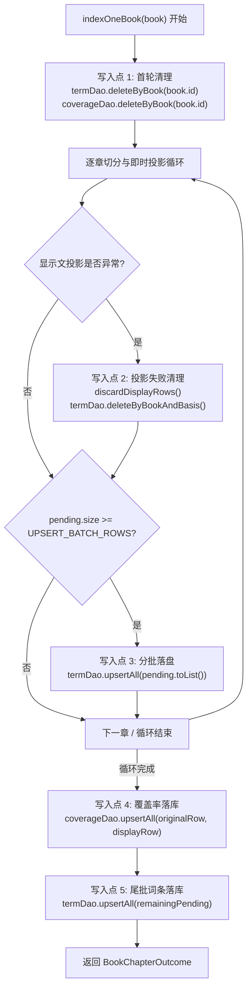
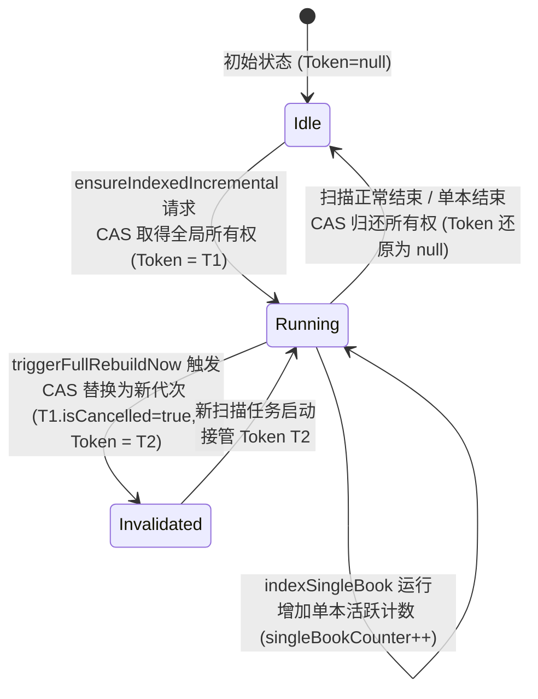
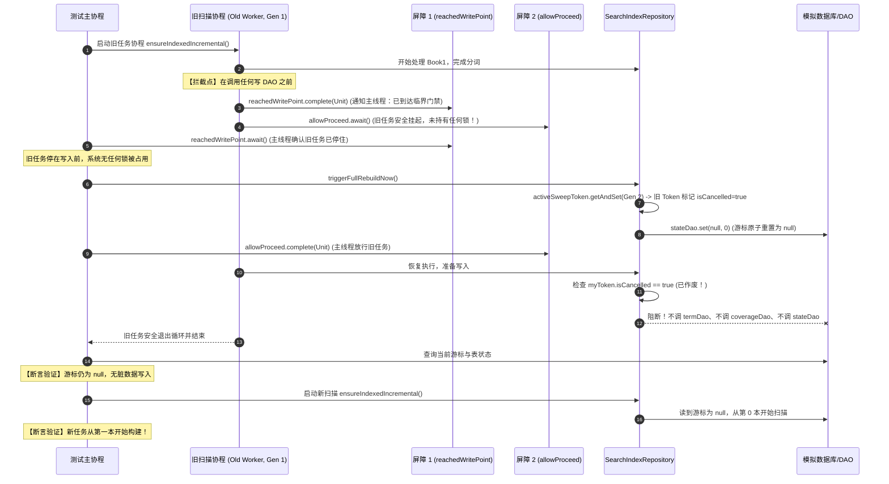

# S03-1 调查与设计报告（修订版）：全量重建搜索索引代次令牌、所有权协议与无死锁并发测试设计

> 工作仓库：`D:\develop\Code\Codex\creation-reading-assistant-recovery-20260919`  
> 分支：`codex/recover-worktree-20260920`  
> 基准 HEAD：`5aed5939600e491843e3c44453921bd6273a233c`  
> 本轮状态：**只读调查与方案设计（针对 Codex 第一版复核 PARTIAL 的深度修订）**  
> 约束遵守：零代码修改、零测试修改、零 schema 变更、零 Gradle 构建、零 ADB/真机操作  
> 报告文件：`docs/coordination/legacy-stages/undated/agent-stage-j-search-generation-design.md`  

---

## 1. 复核修订说明与核心审查结论

第一版设计报告经 Codex 复核评定为 `PARTIAL`。本修订版针对复核指出的 7 项关键缺口进行了彻底的机制重构与深度分析：

1. **写面从“游标标量”扩展至“全库关联表”**：核对并覆盖了 `indexOneBook` 内部包括 `search_terms`、`search_index_coverage` 以及显示文失效清理（`discardDisplayRows`）在内的全部写入点；
2. **构建闭环的所有权协议（Task Ownership Protocol）**：统一了 `ensureIndexedIncremental`、`triggerFullRebuildNow` 与 `indexSingleBook` 三者对 `_progress` 和任务生命周期的竞争关系，消除启动与退出双向竞态；
3. **客观权衡两大架构路线**：深入对比“单进程内存令牌与并发控制协议”与“持久化 Generation + SQLite 条件写入（升级 Room v16）”，明确各自的防护边界、重启恢复机制与数据风险，纠正“零风险”等绝对化用语；
4. **纠正锁内挂起调用的死锁与取消隐患**：分析了在 `Mutex.withLock` 内调用 Room 挂起函数的挂起时长、协程取消安全与潜在死锁；
5. **重新设计完全无死锁的确定性测试屏障**：将同步屏障移出写锁临界区，通过无锁前置门禁消除新旧任务间的死锁；
6. **细化 5 项核心并发断言场景**：明确覆盖游标、覆盖数据行、从头启动、运行状态保护、异常/取消退出的完整测试矩阵；
7. **规范证据等级**：明确区分“静态代码审计已证实”、“待运行测试复现”与“系统级真机验收边界”。

---

## 2. 旧扫描与新重建的时序交叠与代码可达性

### 2.1 触发源与并发实体
- **旧扫描实体**：由后台 `SearchIndexWorker` 执行（`SearchIndexWorker.kt:22`），运行于 WorkManager 线程池，调用 `SearchIndexRepository.ensureIndexedIncremental()`；
- **新重建实体**：由用户在 UI 触发（`SearchViewModel.triggerRebuildIndex()` 或 `ProfileViewModel.rebuildSearchIndex()`），或由全局规则变更触发，调用 `SearchIndexRepository.triggerFullRebuildNow()`（`SearchIndexRepository.kt:381`）。

### 2.2 静态代码可达链路（Static Reachability）
1. **时刻 T0**：旧 Worker 正在运行，在 `processChunked` 中处理第 $K$ 本书（分词、解码或等待批量写盘）；
2. **时刻 T1**：用户点击“全量重建”，主线程/UI 协程调用 `triggerFullRebuildNow()`：
   - 执行 `invalidateSweepForFullRebuild()`（`SearchIndexRepository.kt:356-365`）：通过 `stateDao.set` 将游标重置为 `last_scanned_book_id = null, last_scanned_chapter_index = 0`；
   - 执行 `scheduler.triggerNow(force = true)`（`SearchIndexScheduler.kt:64-77`）：使用 `ExistingWorkPolicy.REPLACE` 向 WorkManager 提交新作业。
3. **时刻 T2**：WorkManager 响应 `REPLACE` 策略，给旧 Worker 协程分发取消信号。**但协程取消属于协作式取消（Cooperative Cancellation）**：
   - 若旧 Worker 正在执行 CPU 密集的分词（`tokenizer.tokenizeDocument`）、TXT 文本切分或单步 Room 操作，协程无法立即终止；
   - 若旧 Worker 的 `indexOneBook(bookK)` 在捕获取消前刚好执行完毕并返回 `BookChapterOutcome(completed = true)`；
4. **时刻 T3（游标覆盖）**：旧 Worker 走向 `when` 的完成分支（`SearchIndexRepository.kt:883-889`），执行：
   ```kotlin
   stateDao.set(
       SearchIndexStateRow(
           tokenizer_version = TOKENIZER_VERSION,
           last_scanned_book_id = book.id, // 即第 K 本书的 ID
           last_scanned_chapter_index = 0,
           built_at = System.currentTimeMillis(),
       )
   )
   ```
   **数据库中刚被全量重建重置为 `null` 的游标被旧 Worker 强行写回为 `bookK.id`**。
5. **时刻 T4**：旧 Worker 退出；新 Worker 启动执行 `ensureIndexedIncremental()`（`SearchIndexRepository.kt:277-303`）：
   - 读取到的游标为 `bookK.id`（而非 `null`）；
   - 从第 $K + 1$ 本书开始扫描，**全量重建中第 0 到第 $K$ 本书被跳过，导致这批书籍在本次全量重建中未被重扫**。

### 2.3 证据等级与现状
- **静态代码审查已证实**：`SearchIndexRepository.kt:356-365` 与 `SearchIndexRepository.kt:855,869,883` 之间无任何互斥保护与代次判定，覆盖链路在代码结构上必然可达；
- **待运行测试复现**：总账本（`2026-09-22-current-task-ledger.md:47`）登记为“S03-1 全量重建代次竞态仍开放”，当前工程尚无确定性自动化测试运行复现过此竞争。

---

## 3. 全写入面审计：`indexOneBook` 写入点与全库关联表保护

旧任务在全量重建触发后若未被即时阻断，写入面不仅限于游标，还会持续污染分词表与覆盖率表。核对 `indexOneBook` 的全部写入点如下：



### 3.1 `indexOneBook` 关键写入点逐项核对

| 序号 | 代码位置 | 写入/删除行为 | 并发重叠时的危害 |
|---|---|---|---|
| **W1** | `SearchIndexRepository.kt:921-924` | `termDao.deleteByBook(book.id)`<br>`coverageDao.deleteByBook(book.id)` | 若旧任务处理的书恰好已被新任务处理完，旧任务的清空操作会**直接抹除新任务刚建立的新索引**。 |
| **W2** | `SearchIndexRepository.kt:941, 1400-1410` (`discardDisplayRows`) | `termDao.deleteByBookAndBasis(bookId, DISPLAY)` | 旧任务的规则投影失败，会误删新任务在该书已写入的合法显示文索引行。 |
| **W3** | `SearchIndexRepository.kt:1104, 1232` | `termDao.upsertAll(pending.toList())`（分批落盘） | 将旧规则、旧分词器下生成的词条分批写入数据库，在新任务已清空/重建后写入陈旧词条。 |
| **W4** | `SearchIndexRepository.kt:1362-1387` | `coverageDao.upsertAll(...)`（覆盖率落库） | 将旧扫描计算出的完成度（如旧规则下的 FAILED 或 PARTIAL）覆盖新任务的覆盖率状态。 |
| **W5** | `SearchIndexRepository.kt:1389-1396` | `termDao.upsertAll(slice)`（尾部词条落库） | 将残留的未满批次词条写回数据库，产生数据倒退。 |

### 3.2 阻断旧任务写入两张表的保护机制
要避免旧任务的晚到写入覆盖新任务结果，代次作废机制必须**前置并渗透**到所有 DAO 写入点之前：
1. **入书门禁（Guard before Book）**：进入 `indexOneBook` 首行必须校验当前任务代次是否仍然有效。若已作废，**绝不调用 W1（不删除任何已有索引）**，立即返回；
2. **批次落盘门禁（Guard before Batch Flush）**：在 W3 分批落盘和 W5 尾批落盘前校验代次。若已失效，直接清空 `pending` 缓存并退出，**绝不调用 `termDao.upsertAll`**；
3. **异常清理门禁（Guard before Display Discard）**：在 W2 `discardDisplayRows` 执行前校验代次。若已失效，仅清理内存 `pending`，**不调用 `termDao.deleteByBookAndBasis`**；
4. **覆盖率落盘门禁（Guard before Coverage Flush）**：在 W4 `coverageDao.upsertAll` 前校验代次。若已失效，**放弃写入覆盖率**；
5. **游标推进门禁（Guard before Cursor Advance）**：最后一步通过代次比对或条件更新，确保失效代次无法改写 `search_index_state`。

---

## 4. 全生命周期所有权协议（Task Ownership Protocol）

针对 Codex 复核提出的缺口 2，分析 `ensureIndexedIncremental`、`triggerFullRebuildNow` 与 `indexSingleBook` 三者交叠场景，建立统一的所有权协议。

### 4.1 现状冲突分析
1. **`indexSingleBook` 粗暴覆写进度（`SearchIndexRepository.kt:461, 475`）**：
   `indexSingleBook` 在被来源刷新（S04-2）或撤销删除（S03-3）调用时，会在开头设置 `_progress.value = Progress(..., isRunning = true)`，并在 `finally` 中执行 `_progress.value = Progress(..., isRunning = false)`。
   - **冲突**：若此时全库扫描 `ensureIndexedIncremental` 正在后台运行，`indexSingleBook` 退出时会**瞬间将全库扫描的 `isRunning` 强行抹成 `false`**；
   - **连锁反应**：UI 的扫描指示器异常消失；且行 271 的并发守卫（`if (_progress.value.isRunning) return PROGRESSED`）被击穿，导致新的周期扫描重复并发进入。
2. **`triggerFullRebuildNow` 抢先置 false（`SearchIndexRepository.kt:392`）**：
   全量重建在触发 Worker 之前，为了避免被行 271 守卫拦截，强制设置 `_progress.value = Progress(..., isRunning = false)`。若旧扫描仍在运行，此赋值直接扰乱了真实状态。
3. **启动竞争（Start-up Race）**：
   两个 Worker 或调用者几乎同时通过 `if (_progress.value.isRunning)` 检查（因为 `MutableStateFlow` 的读取与赋值不是复合原子操作），导致两个作业同时进入扫描循环。

### 4.2 统一所有权协议设计



#### 协议核心组件：
```kotlin
/** 扫描代次与取消令牌 */
class SweepToken(val generation: Long) {
    @Volatile var isCancelled: Boolean = false
}

// 全局活跃令牌（原子引用）
private val activeSweepToken = AtomicReference<SweepToken?>(null)
// 单调递增的代次发生器
private val generationSequence = AtomicLong(1L)
// 单本书即时索引活跃并发计数
private val singleBookTaskCount = AtomicInteger(0)
```

#### 状态迁移与所有权规则：
1. **全库增量扫描启动（`ensureIndexedIncremental`）**：
   - 必须通过原子 CAS 抢占执行权：
     ```kotlin
     val nextGen = generationSequence.incrementAndGet()
     val candidate = SweepToken(nextGen)
     if (!activeSweepToken.compareAndSet(null, candidate)) {
         // 已有扫描在运行，拒绝并发进入
         return IndexSweepResult.PROGRESSED
     }
     ```
   - 彻底消除“检查 `isRunning` 与设置 `isRunning` 之间的竞态窗口”；
   - 广播 UI 状态：`updateProgressRunning(true)`。
2. **全量重建介入（`triggerFullRebuildNow`）**：
   - 不再盲设 `isRunning = false`，而是通过 `getAndSet` 原子作废旧令牌并生成新代次：
     ```kotlin
     val nextGen = generationSequence.incrementAndGet()
     val newToken = SweepToken(nextGen)
     val previousToken = activeSweepToken.getAndSet(newToken)
     previousToken?.isCancelled = true // 立即通知在跑旧任务作废
     ```
   - 旧任务在下一个写入检查点看到 `isCancelled == true` 即刻退出；
   - 新 Worker 被调度起后，直接承接 `newToken`。
3. **单本索引解耦（`indexSingleBook`）**：
   - `indexSingleBook` **不得覆盖或清空 `activeSweepToken`**；
   - 引入 `singleBookTaskCount.incrementAndGet()` 与 `decrementAndGet()`；
   - 全局进度条的 `isRunning` 计算规则更新为：
     `val isBusy = activeSweepToken.get() != null || singleBookTaskCount.get() > 0`
   - `indexSingleBook` 在其 `finally` 中只做 `singleBookTaskCount.decrementAndGet()` 并按上述规则刷新 UI，**绝不强制清零全库扫描的运行态**。
4. **全库扫描安全退出（`finally` 协议）**：
   - 旧任务退出时执行严格 CAS：
     ```kotlin
     activeSweepToken.compareAndSet(myToken, null)
     updateProgressRunning(activeSweepToken.get() != null || singleBookTaskCount.get() > 0)
     ```
   - 若 `myToken` 早已被 `triggerFullRebuildNow` 替换（CAS 失败），**说明已有新代次接管，旧任务的退出绝不将状态还原为 Idle**。

---

## 5. 两大技术路线客观权衡对比

针对 Codex 复核提出的缺口 3，深入对比“单进程内存锁/令牌”与“持久化 Generation + SQLite 条件写入（Room v16）”两条路线。

| 评估维度 | 路线一：单进程内存令牌与并发控制协议 | 路线二：Room Schema 升级至 v16（持久化代次 + SQLite 条件写入） |
|---|---|---|
| **核心机制** | 单例内存 `AtomicReference<SweepToken>` + 写入前 volatile 标记检查 | `search_index_state` 表增设 `generation` 列，SQL 条件 `WHERE id=1 AND generation=:expected` |
| **能保护的写入面** | **全写入面**（通过入书门禁、批次门禁、覆盖率门禁阻断 W1~W5，且游标通过代次匹配保护） | **绝对保护游标行**；对 `search_terms` 和 `coverage` 的保护仍需依赖应用层前置查询判断 |
| **锁占用与挂起风险** | **零锁占用**（纯无锁 AtomicCAS + volatile 读，无 `Mutex`，无挂起调用阻塞） | 无互斥锁，依赖 SQLite 内置单行事务排他锁（毫秒级） |
| **进程重启后如何继续** | 内存代次随进程重置。进程重启后由 WorkManager 或冷启动重新调度，从数据库既有游标继续增量扫描 | 数据库保存单调递增代次，跨进程重启依然能识别陈旧代次 |
| **Room Schema 变更** | **无需修改**（保持当前 Room Schema v15 完全不变） | **必须升级至 v16**，生成 `16.json`，增加 migration 代码 |
| **数据迁移与测试风险** | **零数据库迁移风险**；无需处理升级回滚；测试受限于内存环境 | **存在迁移升级风险**；必须编写 15→16、14→16 迁移用例并在 Android 真机上运行通过 |
| **多进程支持能力** | 仅适用于单进程应用（CRA 当前为单进程架构） | 原生支持跨独立进程 Worker 并发控制 |
| **推荐结论** | **强烈推荐（本阶段首选最小高内聚闭环方案）** | **架构演进备选方案**（若产品后续拆分多进程再行引入） |

> **关键澄清**：路线一虽无 schema 迁移风险，但并非“绝对零数据风险”。其有效性完全依赖于代码中所有 DAO 写入点均严格履行代次前置检查；若遗漏某处写入检查，仍存在并发污染可能。因此必须由完备的单元测试网进行确定性拦截验证。

---

## 6. 纠正锁内挂起调用与无死锁确定性测试屏障设计

针对 Codex 复核提出的缺口 4 与缺口 5，彻底纠正第一版伪代码在 `Mutex.withLock` 内调用挂起函数导致的死锁与取消风险，并重新设计测试屏障。

### 6.1 第一版死锁缺陷剖析
第一版伪代码提出：
```kotlin
// ❌ 错误设计：在互斥锁内调用挂起函数
cursorMutex.withLock {
    if (myGen == gen.get()) {
        stateDao.set(...) // 挂起函数！
    }
}
```
**严重隐患**：
1. **死锁发生**：若测试为了拦截旧任务，在 `stateDao.set` 的 mock 实现中挂起等待测试指令，此时旧任务已持有 `cursorMutex`；测试主线程随后调用 `triggerFullRebuildNow()`，其内部也试图获取 `cursorMutex`，导致**测试主线程与旧任务相互死锁**；
2. **挂起取消风险**：若协程在持有 `Mutex` 期间被取消，锁释放处理虽由 `withLock` 保证，但挂起期间长久占锁会导致其他调度全面停摆。

### 6.2 纠正：采用无锁内存协议（Lock-Free Protocol）
改用**无锁 Atomic CAS 协议**：
- 代次检查、作废与游标判断均通过原子变量与不可变状态完成；
- 不使用跨挂起函数的协程 `Mutex`，从根本上杜绝死锁可能。

### 6.3 重新设计的无死锁确定性测试屏障

测试必须 100% 确定性运行，严禁使用 `delay()` 或 `Thread.sleep()`。使用两个协程屏障（`CompletableDeferred<Unit>`）进行精确双向握手：



#### 屏障无死锁保证：
- **旧任务挂起时未持有任何锁**：拦截点位于 `reachedWritePoint.complete()`，此时旧任务尚未发起数据库操作；
- **新任务执行不受阻**：新任务 `triggerFullRebuildNow` 可以畅行无阻地更新代次与重置数据库游标；
- **顺序绝对确定**：不需要任何基于时间的猜测，完全由屏障严格推进。

---

## 7. 完整验证断言清单（针对缺口 6）

后续实现必须建立独立的测试文件 `SearchIndexRepositoryRebuildConcurrencyTest.kt`，逐一提供以下 5 个维度的确定性验证用例：

### 用例 1：旧任务不能覆盖重置后的书级与章节游标
- **前置**：书架有 `[Book1, Book2]`，旧任务处理完 Book1，即将写回 `last_scanned_book_id = Book1.id, last_scanned_chapter_index = 0`；
- **操作**：旧任务在写入前挂起，主线程触发全量重建（游标置 `null`），再放行旧任务；
- **断言**：`stateDao.get()?.last_scanned_book_id` 必须仍然为 `null`；章节游标必须为 `0`；旧任务被拒绝写回游标的计数恰好为 1。

### 用例 2：旧任务不能在新一代写入后覆盖 `search_terms` 与 `search_index_coverage`
- **前置**：旧任务正在执行 `indexOneBook(Book1)`，已积累待落盘的词条批次；
- **操作**：在分批 `termDao.upsertAll` 与 `coverageDao.upsertAll` 之前拦截，主线程触发全量重建并由新任务写入 Book1 的新版索引；放行旧任务；
- **断言**：旧任务的 `termDao.upsertAll`、`coverageDao.upsertAll` 以及 `discardDisplayRows` 调用被阻断，调用次数为 0；数据库内保留的完全是新代次的数据。

### 用例 3：新扫描必须从第一本书从头开始构建
- **前置**：全量重建触发后，旧任务已安全拦截退出；
- **操作**：调用 `ensureIndexedIncremental()` 启动新扫描；
- **断言**：新扫描内部读取到的起始下标 `startIdx` 必须为 `0`，首本处理的书必须是排序后的第一本书 `Book1`。

### 用例 4：旧任务的 `finally` 不能清掉新任务的运行状态
- **前置**：旧任务在挂起阶段，主线程触发重建并启动了新扫描，新扫描已将 `_progress.value.isRunning` 设为 `true`；
- **操作**：放行旧任务，使其进入其自身的 `finally` 块并退出；
- **断言**：旧任务退出后，`_progress.value.isRunning` 必须仍然为 `true`；只有当新扫描也退出其 `finally` 时，`isRunning` 才转为 `false`。

### 用例 5：取消与单本索引失败路径仍正确退出
- **用例 5a（CancellationException 透传）**：当旧任务在协程取消时被中断，确保 `CancellationException` 正确向外抛出给 WorkManager，不被误吞为正常成功或伪装成静默完成；
- **用例 5b（单本失败隔离）**：在正常扫描（无并发重建）时，单本书解析抛出普通异常，依然能安全记录错误并为该书落锚点，游标正常推进到下一本，扫描循环不崩溃。

---

## 8. 边界、证据等级与风险声明（针对缺口 7）

### 8.1 规范证据等级表述
- **关于数据一致性影响**：修正第一版“已发生永久数据丢失”的不严谨表述。准确表述为：**代码可达的逻辑竞态风险。一旦发生，旧游标覆盖会导致全量重建跳过前序书籍的重扫；需要用户再次手动触发全量重建方可纠正**。
- **关于无 Schema 方案的风险**：修正第一版“零风险”的绝对化表述。准确表述为：**无 Schema 迁移风险方案，避免了数据库版本升级引发的冷启动崩溃隐患；但其安全性依赖于仓储层写入边界的全面门禁防护，需由完备的单元测试验证**。
- **关于验证能力边界**：修正第一版“JVM 可 100% 封闭验证”的夸大表述。明确区分：
  - **JVM 单元测试能够 100% 确证的部分**：协程并发协议、内存令牌 CAS 替换、无锁屏障时序、DAO 写入拦截与进度状态隔离；
  - **JVM 单元测试无法覆盖的部分**：跨物理进程的强杀行为、系统级 `WorkManager` 基于电量/网络约束的调度行为。

### 8.2 验收边界划分
1. **代码与 JVM 验收阶段**：
   - 运行定向 JVM 测试：`.\gradlew.bat :app:testDebugUnitTest --tests "com.creationreadingassistant.data.repository.SearchIndexRepositoryRebuildConcurrencyTest" --no-parallel --rerun-tasks`；
   - 运行现有测试回归：`SearchIndexRepositoryTest`、`SearchIndexBookRefreshCoordinatorTest`；
   - 验证 5 项核心并发断言全部以 100% 确定性通过。
2. **系统设备验收阶段（待后续由 Codex 安排）**：
   - 仅在已连接的真实 Android 设备上执行全量重建手势/按钮操作，通过设备日志观察后台 Worker 重建流程是否平稳，不使用 MuMu 模拟器。

---

## 9. 文件所有权清单与 SEAM REQUEST

### 9.1 文件所有权规划

| 文件路径 | 性质 | 权限范围 | 变更内容概述 |
|---|---|---|---|
| `android/app/src/main/java/com/creationreadingassistant/data/repository/SearchIndexRepository.kt` | 修改 | Codex 共享 owner | 实现无锁 `SweepToken` 协议、入书/批次/覆盖率写入门禁、解耦 `indexSingleBook` 进度 |
| `android/app/src/test/java/com/creationreadingassistant/data/repository/SearchIndexRepositoryRebuildConcurrencyTest.kt` | 新增 | 本任务独占 | 承载 5 项确定性并发屏障测试用例 |
| `docs/coordination/legacy-stages/undated/agent-stage-j-search-generation-design.md` | 修改 | 本任务独占 | 架构设计报告（本文档） |

### 9.2 严格禁止触碰的文件清单
- 数据库 Schema / 迁移 / Entity / DAO：`AppDatabase.kt`、`SearchTermDao.kt`、`15.json`（**零修改**）；
- 调度器与 Worker：`SearchIndexScheduler.kt`、`SearchIndexWorker.kt`（**零修改**）；
- 业务领域实体与其他模块：`BookRepository.kt`、`ShelfImporter.kt`、`ShelfViewModel.kt`（**零修改**）；
- 总账本文件：`2026-09-22-current-task-ledger.md`（**零修改**）。

### 9.3 SEAM REQUEST 评估结论
- **结论：无需发起 SEAM REQUEST**。
  - 所选方案完全在 `SearchIndexRepository.kt` 的内部实现与私有成员范围内闭环；
  - 对外暴露的公共 API（`ensureIndexedIncremental`、`triggerFullRebuildNow`、`indexSingleBook`、`progress`）方法签名与返回值语义保持 100% 兼容；
  - 不涉及任何跨模块接口变更，不影响其他 Agent 的工作边界。

---

> 本报告调查与设计已全面修订完毕，已停止一切工具调用，等待 Codex 最终复核裁决。
