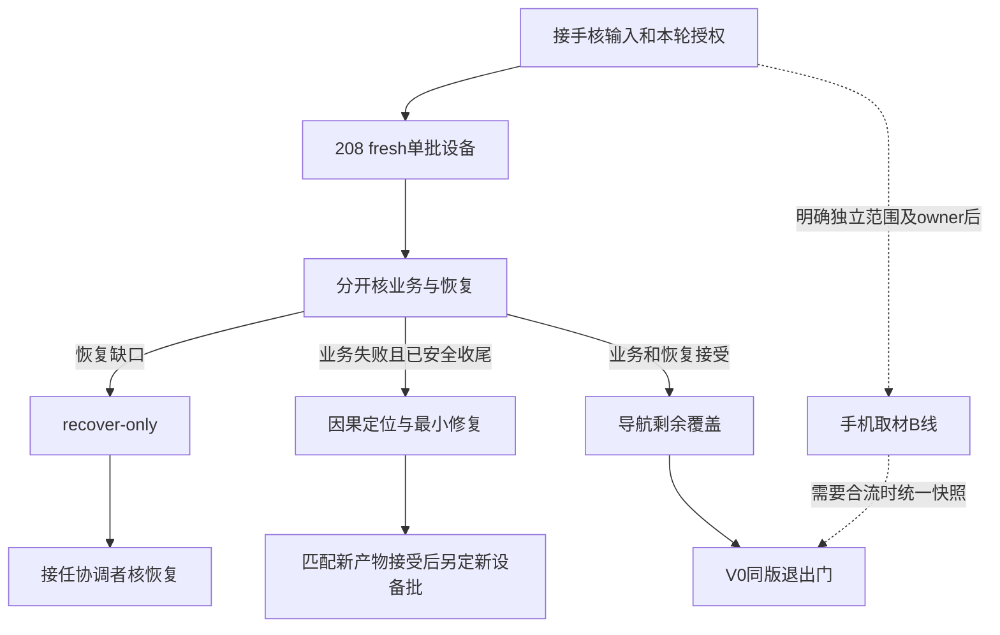

# 原生Android后续任务与接任执行手册

编制：2026-10-31（香港时间）。用途：用户把本文件交给其他 agent 后，接任者无需等待原Root额度恢复，即可确定下一步、承担协调/实施/核验职责并交付可接续成果。本文件是执行方法和条件任务清单；精确候选、授权、当前任务及结果只维护于 [current.md](current.md)，不在本文件复制一套会漂移的指纹台账。

**编制时处于用户暂停状态。当前请求只授权编写接续文档，不恢复自动化、不向ZCode发消息、不启动设备任务。** 用户以后在另一 agent 中明确交办相应任务，该 agent 按该轮授权接续；不要把“读文档/看看进度”当设备执行许可，也不要因为换了 agent 就重复索取已经明确给出的同一批许可。

> 最新排期：先读[AR八项队列](../coordination/2026-11-02-antigravity-next-queue-v2.md)、[Root九卡交付复核](../coordination/2026-11-02-antigravity-stage-delivery-review.md)和[新提示词](antigravity-next-prompt-v2.md)。原AG九卡部分交付尚未闭合，AR01/02先修门；本手册C1/208等只为历史方法，不作为重跑命令。

## 1. 接任方式：职责可以移交，不依赖原窗口

- 本项目的“Root”是总协调职责，不绑定某个模型或本聊天。用户明确让你接手总协调时，你可以维护current/state、分配互斥文件所有权、核验交付、接受或拒绝候选、编写下一轮合同。无需等待原Codex回来盖章。
- 用户只交给你单项任务时，你只拥有该合同的可写范围；不能因此改全局计划、接管同一设备或覆盖现有owner。
- 用户把一份已完整列明范围的任务交给你并明确要求执行，可作为该任务授权依据。你应记录用户这次指令及日期、任务版本、输入范围、停止点，再开始对应动作；不要要求特定口令或要求原Root重复确认。仅泛泛要求“自动化接着跑”不能扩展到合同明确未授权的设备/发布操作。
- 若另一个 agent 已持有同一candidate/Gradle/设备，先完成所有权交接。不能通过切换模型/新开会话绕开资源占用。
- 若原Root额度不足或离线，报告交给用户或用户指定的接任协调者即可；不是阻塞理由。确有产品范围、数据许可或不可逆选择时才向用户提一个具体问题。

## 2. 最短启动：先确定任务，再按链接读取

按顺序读取，当前上下文已加载且未变化的内容直接复用：

1. 活动仓库 `D:/develop/Code/Codex/creation-reading-assistant-recovery-20260919/AGENTS.md` 和用户级 `C:/Users/23254/.codex/AGENTS.md`。Codex接任者另遵守本机Codex vault入口规则；其他 agent 不因此获得读取Codex/DSH/Claude等私有记忆库的许可。
2. [current.md](current.md)：权限、暂停、唯一候选、已验与未验、下一步、文件owner。
3. 本手册相应任务卡；[208设备合同](../coordination/2026-10-31-task208-ordinary-reopen-fresh-device.md)只在需要208时读。
4. `E:/creation-reading-assistant/coordination/android-zcode-luna-state.json` 的 `a`、`b`、`currentTask`、`automationAuthorization` 以及当前任务对应的最新Review；这些是摘要，验收仍以报告和原证为准。
5. 只读本任务所需原报告、源码差量、日志/XML、patch、APK。路径失效先查 [document-map.csv](../document-map.csv)，不加载全部历史、不宣布原件丢失。

启动输出应简短：这次接任的职责、实际任务版本、已确认输入、是否具备权限、实际owner/工作区、下一具体动作。没有新证据就不要重讲历史。

### 开始写入前必须做的事

用文件内容SHA或等价精确版本核对实际输入；仅文件时间/大小相同不够。检查已有WIP，不能reset/checkout、清空目录、全仓格式化、重复复制完整工程。写current/state前核读取指纹，发现变化先重读合并。不能把D仓库源码与E候选视为同一份输入。

## 3. 接续队列与依赖图

下面是执行卡标识，**不是提前占用的全局任务编号**。编制时任务编号为208-v1，已不作为当前首项；后续编号由接任协调者检查state/current及相关任务索引后登记，避免冲突。条件未成立的工作不得提前标执行中。

| 卡片 | 工作与进入条件 | 直接产出 | 依赖/权限 |
|---|---|---|---|
| C0 | 确认交付快照、owner、用户本轮授权 | 接手说明及明确下一动作 | 只读可做；暂停时不能据此执行产品/设备操作 |
| C1 | 208-v1：新APK普通退出/重开单批MuMu | 真实业务结果和独立恢复原证 | 当前首个待办；需本批设备授权，详见完整208合同 |
| C2 | 接任协调者审核208交付 | 业务/恢复分别裁决、更新现态 | 有新ready/REPORT才核；不要求原Root在线 |
| C3 | 若业务FAIL：保持现场、完成约定恢复后定位/最小修复 | 原红、因果证据、定向修复和匹配产物 | 先处置恢复安全；设备新重试不在本卡授权内 |
| C4 | 若恢复FAIL/PARTIAL：recover-only闭环 | 恢复结果与数据/APK/设置比对 | 优先于新业务；独立合同/唯一设备owner，不重跑业务 |
| C5 | 208业务和恢复都可接受后，处理导航剩余运行覆盖 | 图测试/原入口/失败取消等逐项覆盖账 | 编译证据可复用；设备方法/expectedCount需独立新合同 |
| C6 | 稳定候选V0五合同合流核验 | 同版证据矩阵和内部交付结论 | 仅补实际缺口，不把208单方法PASS写成整版PASS |
| C7 | 独立手机取材B线 | 从现有成果接通可用的最小手机流程 | 首先核已有成果，精确写范围后实施；不改冻结candidate |



无安全恢复许可、输入漂移、缺少合法宿主接缝或设备owner时，停依赖动作并保全证据；可以继续互不依赖且已授权的离线工作。不要给“所有任务阻塞”或为并行数量制造审计。

## 4. C0：开工就能做的最小输入核对

**成功标准**：确认current所列匹配APK对仍在实际candidate、SHA一致；明确最新207-r4只接受源码/编译/产物，Android运行仍NOT_RUN；208尚未派发的状态有没有被新用户指令改变。

- 当前唯一Android构建工作区见current，不能另建一套工程/缓存。
- 207-r4交付根：`E:/creation-reading-assistant/task207-reader-exit-stack-repair-v1/recheck-r4/`。Root限定结论见其 `root-review/REPORT.md`、`checks.json`；不要只信ready中的状态字符串。
- 有必要时对current指定的APK、当前受改源码及冻结203方法源码实算SHA；不能为交接重跑JVM/Gradle。充分旧原日志、签名和指纹关系可引用。
- 原205业务红和206有限恢复的限制见current；不重新审历史D，不重做206恢复。
- 原交付包被覆盖/实际SHA变更：记录哪个输入变化、谁持有写权限，停设备依赖，找对应新版本或保全原件。不得用旧结论套新APK。

只读核对可在新会话执行；当前用户只要求文档时，核到这一步也不能自行恢复暂停。

## 5. C1：208-v1设备任务的具体接续

完整业务、输入pins、权限、存储、恢复、停止条件已在 [208合同](../coordination/2026-10-31-task208-ordinary-reopen-fresh-device.md)，必须完整交给执行者。当前该稿待授权；本手册不重复复制其APK数值，以current/合同/实际原件三者核同为准。

### 5.1 固定机制入口与安全读取顺序

这些是**只读定位线索**，不是命令你运行旧driver：

| 机制/参考 | 实际路径 | 怎样使用 |
|---|---|---|
| 生产统一入口 | `E:/creation-reading-assistant/task192-reader-internal-lifo-host-offline-v1/host/entry_lifo_192.py` | 新208仍经此入口，读取其绑定和finally，不改它 |
| 单方法宿主/输入校验 | 同目录 `host192.py` | 核 `verify_inputs_192`、schema、目标方法、合法runId/scope和CLI；waiting输入必须拒绝执行 |
| 恢复实现 | `E:/creation-reading-assistant/task166-quiet-writer-recovery-v1/host/host166.py` | 原同源HOST158/166恢复合同，只读复用，不自行简化 |
| 身份适配 | `E:/creation-reading-assistant/task179-instance-identity-adapter-offline-v1/recheck-r3/` | fresh完整身份，不能旧serial/boot硬编码 |
| keepalive实际绑定 | `E:/creation-reading-assistant/task184-strict-keepalive-entry-offline-v1/recheck-r2/keepalive_entry_r2.py` | 由入口绑定实际parent，结束finally还原 |
| 上次设备driver结构 | `E:/creation-reading-assistant/task205-ordinary-reopen-device-v1/{preflight_205.py,prepare_inputs_205.py,run_batch_205.py,postflight_205.py}` | 按需读实现和已知缺口；禁止直接执行旧205路径/旧runId |
| 恢复缺口反例 | current中task205Review/task206Review及对应报告 | 不沿用旧“全绿”口号，原rc/userState/binding/末态保护分别核实 |

208需最小新driver/inputs时，在208任务根制作差量，只更新本批真实输入和绑定；不复制冻结宿主/依赖闭包来绕路径门。任何固定校验不支持新输入，应报告准确拒绝原因，不能改冻结校验器迎合。

### 5.2 开始运行之前

1. 记录本轮用户明确授权、任务208-v1、唯一owner、实际开始时间；若用户只是让你审核或保持暂停，停在准备状态。
2. 核candidate/APK/目标方法与合同指纹，确认无其他写candidate/用设备的agent；实际可用空间及新增体积估算写REPORT。
3. 按完整fresh身份机制查实际设备及原实例，生成新runId/new scope；记录userState、八设置/focus、原APK对/安装归属、71private/820external/DB-WAL-SHM基线与冻结恢复依赖。
4. 后续所有adb都显式绑定本轮serial。预检任一关键命令rc异常，不当空输出通过；基线漂移停，不自动改库/换实例。
5. 26role输入与scope/runId/owner/preflight/serial/boot共同绑定。不能把说明文档中的旧值填入新证据。

宿主CLI需填写的实际参数为 `--run-id`、`--inputs`、`--run-scope`、`--serial`、`--boot-id`；`--approve-device`/`--approve-quiesce`只能在对应用户许可实际存在时使用。**本文件不提供带旧身份的可直接运行命令。** 由owner依据上述实际读取的host参数组装一次argv并保存原件，不能用拼写参数替代业务授权。

### 5.3 唯一运行范围

只运行208合同指定的冻结203单方法、expectedCount=1、一次main和一次instrument。不得顺手跑整个新图测试类、生产UI新测试或全suite；那些要走C5的新合同。不能现场改APK、断言、超时、夹具或运行模式。退出/书架重开未实际执行时，必须明确停在哪一步。

### 5.4 业务后的收尾

正常或异常都按166完整合同进入安全恢复。业务FAIL不取消恢复，恢复FAIL不取消原业务红。保护原数据/APK/设置是交付的一部分，不能以“时间到/agent额度到”代替恢复；但也不能无限循环恢复操作。到明确安全停止点后移交真实原件和未完成动作。

## 6. C2：208交付核验与四条分支

接任协调者可独立完成本核验。无需原Root在线，也不因看见ready就认通过。

### 6.1 最小核验顺序

1. 对照本轮任务/输入/owner/runId/scope/实际serial/boot及授权记录。新runId不能是205/206旧attempt。
2. 核ready和REPORT列出的真实路径、size/SHA；report/ready不能自引用SHA，省略/摘要不能替代原rc/stdout/stderr。
3. 从真实main结果与instrument原输出核实际class#method、expectedCount=1、Tests/Failures/Errors/terminal/rc；正文/位置/保存/退出书架/重开到底走到哪一步由实际输出和方法体共同解释。
4. 独立核恢复原件：父正常卸载或KEEP裁决、原APK/data/userState/八设置focus、四tar的成员type/size/内容SHA、71private/820external/DB比对、strictkeepalive及所有保护之后的最终identity。不能只读执行者summary。
5. 按实际受影响输入复用充分旧证。不为交接重复业务或恢复，不全量构建。

### 6.2 决策表

| 业务 | 恢复 | 结论 | 接下来做什么 |
|---|---|---|---|
| PASS且普通退出/重开实际完成 | 全部本批合同保护可核接受 | 仅本批MuMu单方法接受 | 记录新结果与旧205红各自输入，进入C5，不报全产品PASS |
| FAIL/崩溃/超时 | 可核恢复接受 | 业务失败，恢复接受 | C3；不自动再跑第二次同用例 |
| PASS或FAIL | FAIL/PARTIAL/关键恢复缺证 | 设备收尾未闭合 | C4优先，禁止新业务；保留业务本身结果 |
| 未运行/身份或基线失败 | 未开始或仅预检 | 预检BLOCKED/NOT_RUN | 修准确输入/授权/owner缺口；不写业务FAIL，也不在设备上试探性绕门 |

报告如实保留“有限接受”限制。业务PASS不证明实体机、全生命周期、所有pending失败或异步保存异常都已覆盖；恢复接受不改变业务FAIL。

## 7. C3：业务仍失败时的下一项离线修复

**进入条件**：已拿到新批真实失败和原日志，恢复已安全闭合或明确安全交接；不是凭“没有ready/界面还在响应”判断缺陷。

**目标**：最小区分保存失败、导航返回栈残留、入口或加载会话问题，不把猜测写唯一根因。先复现当前失败条件，再改最小相关实现；已有静态改动/旧绿不得替代新输入验证。

1. 对照本次异常栈/原stderr/DB行/实际导航到达点，定位最后一项已完成的用户动作。`exitAttempt.failure == null`只证明点击调用未抛错，不能排除`awaitProgressSaves`协程失败。
2. 初始只读定位从 `ReaderRoute.kt`、`ReaderTemporaryNavigationProductionTest.kt`、冻结203测试、ReaderScreen退出保存边界开始。修导航和保存时，先理解真实调用点，不能只改测试镜像或NavOptions mock。
3. 精确列需要写的文件/hunk及原因。若失败证据指向ReaderScreen/ViewModel/存储边界，应由接任协调者单独给出新范围，不强逼执行者在ReaderRoute里绕过问题；用户已有范围内的必要小修无需重复请原Root批准。超出产品范围、数据权限或不可逆操作才问用户。
4. 修复owner承担必要定向编译/测试与交付，用既有唯一candidate和锁。存储/patch/report按第11节；不能放宽原断言/timeout使测试绿。
5. 改产物后独立核新源码/APK对，写新设备合同；原失败scope不复用，不凭离线绿自动重试设备。

**同根因/同接口两轮不闭合**：协调者必须改变方法或owner，例如先在真实生产接缝做最小证据试验、减少镜像测试，而不是复制相同长提示词升版本。报告准确说哪条假设被否定、下一项能区分什么；不靠加防御catch/默认值隐藏失败。

## 8. C4：恢复问题的独立recover-only接续

**第一原则**：不继续业务，不把“卸载了”当数据已恢复，也不能在未知数据状态下清理现场。

- 从新批真实scope/备份/冻结恢复决策接手；交出原userState/三根保护/设置/安装归属/原APK可用性和实际停在哪个阶段。
- 新合同明确recover-only、同实例、唯一设备owner、允许操作及最多次数、何时KEEP与停止。不得重做已成功的破坏性步骤“补证”，不得手写卸载替代166父正常恢复门。
- 修复范围通常是本任务driver的证据保存或实际绑定；冻结host/collector/consumer如有真实问题，先按外部边界失败快速停止并交准确根因，不在设备现场改冻结校验。
- 新报告对每项恢复保护分别列原件路径/rc/结果，不覆盖原REPORT声称“从未失败”。若原数据损坏或无法恢复，如实阻塞数据安全合同，立即告知用户。
- 完整收尾接受后再决定C3或C5。历史206有限关闭不是这次恢复成功的证据。

## 9. C5：208通过后，如何处理导航剩余运行缺口

**这里不预先写“已通过”。** 当前新图测试7项、新生产UI测试1项只有源码/编译交付；实际运行结论应来自将来的合法设备合同。

1. 先看208实际覆盖与源码关系，充分的成功链/普通退出重开证据直接引用；与冻结203重复的生产成功链不为凑数量再跑。
2. 原书架/搜索/笔记入口回退，以及pending一级失败、二级取消、真实被取消requestId迟到结果，按真实缺口列矩阵；区分图壳seam与完整ReaderRoute/保存await。
3. 现有 `host192`冻结为203单方法/expectedCount=1，**不能直接替换为图测试类7项或新生产测试方法**。如需新运行目标，先做独立离线runner/collector适配合同，输入写具体class#method/expectedCount，先定向验证解析/绑定/拒绝错误输入，再由独立新设备合同执行；不能修改冻结192来跳过门禁。
4. 生产失败/取消UI目前缺乏合法可控入口/时机。不要为测试新增跨书卡片功能或假加载钩子；先确认这是否现有产品可达风险，选用已有机制证明。确需新注入接缝时，列最小文件和证据目标给协调者，范围判断后才实现。
5. 未运行、不可触发、仅图seam可证的范围始终独立列出；不能用“未触发错误”证明所有自然墙钟竞态关闭。

退出：受影响导航/保存路径有明确同版结论及未覆盖表，足以支持C6逐合同裁决；不是要求无限添加与当前产品无关的场景。

## 10. C6/C7：首版退出与手机取材线

### 10.1 V0五合同，复用优先

详细产品范围见 [Android交付规划](../coordination/2026-10-09-workflow-replan.md)。接任协调者维护一张矩阵：合同、具体用户流程、候选源码/APK、原证路径、实际设备类型、恢复结论、未覆盖项、结论。五项分别是日常阅读、查阅返回、数据保全、明确失败边界、同版交付门。

- 205普通退出修复的新批PASS最多解除对应V0-1/2/5阻塞，不自动接受其他合同。
- D历史证据已限定复用关闭，不重新审全D；F旧会话迟到写入、N1/G1/Room/WebDAV等只按本次改动影响核原证关系。缺证就标明具体哪一项，不能补造状态或把旧总规划当授权。
- 同一候选受影响源码、新宿主与测试APK、实际MuMu结果、恢复后账对得上，才可做范围明确的内部候选结论。全产品分母未定，不给全产品百分比。
- 实体手机/MIUI、发布签名/升级/R8、实际LAN、完整D2、整机中断X等未覆盖范围保留；不因此擅自扩批，也不抹掉实证影响日常必需流程的风险。
- APK交给用户自用、安装到真实手机、正式签名、Git提交/push/PR/发布各是单独操作范围；本手册不授权。

### 10.2 B线只接现有能力，不另起产品

目标为手机阅读→摘录/想法→搜索找回/回源→轻量归类与导出。先从现行交付规划及它指向的23/33等已核成果定位原报告，不重新通用盘点或发明缺陷；本次未重新核这些原件，不能宣称其当前实现/验收已足够。

有了具体原证和代码入口后，协调者选择一个最小真实缺口，单独写合同，逐项写清输入、UI入口、数据字段、回源失败保留内容、导出目的地与文件可核方式、冷启动持久性、清理范围。没有这份范围和用户已有许可前只做只读定点核对，不擅自新增功能。

能不共写阅读/保存接口且不占同一冻结candidate的离线差量可以与设备任务并行；不能在设备正在验收的APK来源上直接改源码。要合流由唯一集成owner安排下一快照/受影响验证，不为并行复制工程或Gradle缓存。

## 11. 统一任务合同、报告与状态写回

### 11.1 以后每项任务开工前都必须有文档

复用 [任务派发模板](../coordination/android-task-dispatch-template.md)。每份合同至少包含：

| 字段 | 必须写到可执行的程度 |
|---|---|
| 身份 | 实际任务编号/版本、日期、状态、执行者和协调者 |
| 输入 | current、直接相关原报告、绝对文件路径、已接受前SHA；未知明确写未知 |
| 目标 | 可观察的用户结果、强验收条件及本轮未覆盖范围 |
| 所有权 | 精确可写文件/目录、唯一candidate/Gradle/设备owner、只读和冻结范围 |
| 步骤 | 先后依赖、入口/参数、应记录的真实输出、失败如何停止/恢复 |
| 权限 | 当前用户指令依据、设备/桌面外部代发/自动化/Git/删除/发布分别是否允许 |
| 资源 | 现有环境与锁、预计新增bytes/空间、禁止工程/缓存重复复制 |
| 验证 | 定向命令/目标、复用原证条件、何时才扩大检查、红→绿保留 |
| 交付 | REPORT/ready/patch/before/after/原log或XML/APK pins的绝对根与大小预算 |
| 停止 | 时间预算、输入/owner冲突、外部权限、恢复失败与未完成清单 |

提示词外标编号、用途、实际可选模型/替代、复杂度、耗时、并行/等待关系；完整提示词放一个至少四反引号且长于内部围栏的代码框。不要只给聊天摘要。用户手动分发时不自动操作外部应用；明确授权代发才用低额度实际模型操控，全文一次、核新消息后放手。

### 11.2 报告最低结构

同一REPORT写：任务编号/版本；输入指纹；所有权与改动；环境；执行与结果；原始证据；未覆盖项；恢复与副作用；交付状态与下一步。命令原rc/stdout/stderr、XML数量、APK/源码SHA与范围要能独立追溯。恢复资产和普通文本分开统计，新增空间全部归账，不另造多套收据。

离线任务默认source/runtime/report/ready≤256KiB、普通raw≤256KiB；设备208普通raw≤512KiB，必要保护capture/tar另列实bytes。具体合同可基于真实需求说明必要例外，不为省空间删原证。大型原件绝对路径引用优先，不逐版本复制工程/APK/cache。

ready最后写，列真实报告/patch/日志/产物路径及size/SHA，不自引用自己的SHA。若任务部分完成，ready状态应是PARTIAL/BLOCKED等真实含义，不能为了让协调者接续假写通过。

### 11.3 更新入口而非继续叠加历史

1. 每轮结束/交接时，更新current当前段落，旧事实/原红不抹掉，历史详细过程留原报告链接；必要保全旧字节，不移动原证。
2. 同步state的a/b/currentTask与该任务Review；`processed=true`只代表已经核查，不代表PASS。readySHA变更后才触发必要复核。
3. 更新本手册的队列导航/新增任务链接时只改有变化的部分；精确SHA仍只放current/任务报告。
4. 汇报“已完成、未完成、下一步”，给出可复制的下一合同路径。不把继续工作的唯一钥匙留在聊天里。
5. Markdown活动入口改动后定向检查链接/状态一致性；不重审所有历史。不得擅自更新私有持久记忆。

## 12. 用户给下一位agent的完整启动提示词（通用模板）

**当前Antigravity实际接任请复制[2026-11-02完整提示词](antigravity-start-prompt.md)，并执行九项队列；下方保留通用委任方式，不作为当前任务清单。**

下面整框可直接复制；本框只委任接手和文档化接续，不自行恢复已经暂停的设备/自动化权限。用户若另明确执行208，应把该授权与本框一起交办，接任者按同一批记录后执行，无需再向原Root询问。

````text
你接任创作阅读助手原生Android恢复项目的协调者。活动仓库D:/develop/Code/Codex/creation-reading-assistant-recovery-20260919。

请先读仓库与用户级AGENTS.md、docs/handoff/current.md、docs/handoff/continuation-playbook.md、E:/creation-reading-assistant/coordination/android-zcode-luna-state.json当前a/b/currentTask及对应最新Review；旧路径失效查docs/document-map.csv，不加载历史全集。

你可以承担接任Root职责，基于实际原证核验交付、维护current/state、制定下一任务合同；无需等待原Codex额度恢复或原窗口批准普通技术决定。每项后续工作先写完整任务文档，再按我的本轮授权执行。当前自动化仍暂停；阅读本框不等于授权设备/ADB/VM或外部代发。若我同时明确交办208及其设备恢复范围，把本轮指令记为该批授权，再照完整208合同执行，不重复请原Root确认。

当前精确成果和下一项先查current及docs/coordination/2026-11-02-zcode-delivery-review-and-epub-next.md：208/R2/E/P5已执行；I/C-R2有限覆盖；EP点击仪器RED，完整旅程硬断言不足。先按209-EP-r1修离线恢复归属/聚合、构建绑定及测试断言；按真实用户许可另落新设备合同。不重跑208/R2/P5，不重做已成功卸载。205业务原红、206有限恢复和D限定复用保留。

只推进已授权的原生Android工作；不碰桌面产品、Git暂存提交pushPR发布、资产删移、D产品回灌、正式库/私库sessionDB或其他agent私有记忆。candidate/Gradle/设备各保持唯一owner。报告交给我或我指定的接任协调者即可。每轮结束更新current/state和下一任务文档，给出已完成、未完成、下一步及报告绝对路径，确保下一位agent仅靠文档可继续。
````
